
<b>Lietuvių</b> · <a href="README.md">English</a>

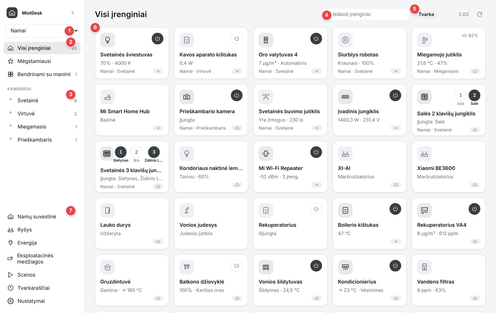

<h1 align="center">MiotDesk — naudotojo vadovas</h1>

Neoficialus Xiaomi Mi Home klientas Windows, macOS, Linux ir Android sistemoms 
Programos versija <b>0.16.0</b> · Vadovo leidimas <b>2.2</b> · 2026-11-02 · lietuvių kalba

> [!CAUTION]
> MiotDesk **nesusijusi su Xiaomi**. Prieš pradėdami perskaitykite [2 skyrių](#safety) „Sauga ir apribojimai“.

| Dokumentas | |
|---|---|
| Pavadinimas | MiotDesk. Naudotojo vadovas |
| Produktas | MiotDesk 0.16.0, skirta Windows 10/11, macOS, Linux (Debian / Ubuntu / Mint) ir Android |
| Leidimas / data | 2.2 / 2026-11-02 |
| Autorius | Aleksandr Igumenov |
| Skaitytojai | Mi Home naudotojai be specialaus techninio pasirengimo |
| Struktūra | Parengta pagal ISO/IEC/IEEE 26514 (informacija programinės įrangos naudotojams) ir IEC/IEEE 82079-1 (naudojimo informacijos rengimas) |
| Kita kalba | [English](README.md) |
| Licencija | MIT — žr. [LICENSE](LICENSE) |

**Leidimų istorija**

| Leidimas | Data | Programa | Pakeitimai |
|---|---|---|---|
| 1.0 | 2026-10-26 | 0.11.8 | Pirmasis leidimas (rusų kalba) |
| 1.1 | 2026-10-27 | 0.11.10 | Nepasiekiamas Xiaomi regionas |
| 1.2 | 2026-10-27 | 0.12.0 | Klaidų žurnalas; pirmasis leidimas anglų kalba |
| 1.3 | 2026-10-27 | 0.12.1 | Šliuzo jutikliai porcijomis; šliuzo pakibimų žurnalas |
| 1.4 | 2026-10-29 | 0.12.2 | Siurblio derinimas; trikčių šalinimas |
| 1.5 | 2026-10-29 | 0.12.3 | Nauja programos versija; nurodymai nepakito |
| 1.6 | 2026-10-29 | 0.12.4 | Gyvas siurblio žemėlapis; trikčių šalinimas |
| 1.7 | 2026-10-30 | 0.12.4 | Leidimas lietuvių kalba; nuorodos tarp kalbų |
| 1.8 | 2026-10-31 | 0.12.5 | Nuolat į lizdą įjungti įrenginiai; „Energija“ plytelės; šliuzo jutikliai iš debesies pranešimų |
| 1.9 | 2026-11-01 | 0.12.6 | Šliuzo jutikliai keliose kopijose; grafikų pabaiga |
| 1.10 | 2026-11-01 | 0.12.7 | Nauja programos versija; nurodymai nepakito |
| 1.11 | 2026-11-02 | 0.12.8 | Neatsakantys šliuzo įrenginiai |
| 1.12 | 2026-11-02 | 0.12.9 | Nauja programos versija; nurodymai nepakito |
| 1.13 | 2026-11-02 | 0.12.10 | Nauja programos versija; nurodymai nepakito |
| 2.0 | 2026-11-02 | 0.15.0 | Windows darbalaukio valdiklis |
| 2.1 | 2026-11-02 | 0.16.0 | macOS ir Android valdikliai; valdiklių išvaizda, tvarka ir vardai; klavišų pavadinimai kelių klavišų jungiklio kortelėje; Linux kiosko režimas; Raspberry Pi |
| 2.2 | 2026-11-02 | 0.16.0 | Übersicht: įdiegimas, valdiklio vieta ir dydis |

## Turinys

- [1. Apie šį vadovą](#about)
   - [1.1 Paskirtis](#purpose)
   - [1.2 Kam skirtas](#audience)
   - [1.3 Kaip naudotis vadovu](#howto)
   - [1.4 Žymėjimai](#conventions)
   - [1.5 Susiję dokumentai](#related)
- [2. Sauga ir apribojimai](#safety)
   - [2.1 Programos statusas](#status)
   - [2.2 Xiaomi paskyros apsauga](#account-safety)
   - [2.3 Privatumas](#privacy)
   - [2.4 Apribojimai](#limits)
- [3. Produkto aprašymas](#product)
   - [3.1 Pagrindinės funkcijos](#features)
   - [3.2 Veikimo principas](#principle)
- [4. Sistemos reikalavimai](#requirements)
- [5. Įdiegimas, atnaujinimas ir pašalinimas](#install)
   - [5.1 Windows](#inst-win)
   - [5.2 Linux (Debian, Ubuntu, Mint)](#inst-linux)
   - [5.3 Raspberry Pi](#inst-rpi)
   - [5.4 macOS](#inst-mac)
   - [5.5 Android](#inst-android)
   - [5.6 Atnaujinimas](#update)
   - [5.7 Pašalinimas](#uninstall)
- [6. Prisijungimas prie Xiaomi paskyros](#login)
   - [6.1 Prisijungimo tvarka](#login-proc)
   - [6.2 Prisijungimo patvirtinimas (dviejų žingsnių patvirtinimas)](#login-2fa)
   - [6.3 Jei nepavyksta prisijungti](#login-errors)
   - [6.4 Atsijungimas](#logout)
- [7. Pagrindinis langas](#main)
   - [7.1 Pagrindinio lango apžvalga](#main-overview)
   - [7.2 Įrenginio kortelė](#card)
   - [7.3 Vaizdas telefone](#mobile)
   - [7.4 Veikimas fone](#tray)
- [8. Įrenginio langas](#device)
   - [8.1 Įrenginio lango antraštė](#dev-head)
   - [8.2 Įrenginio valdymas](#dev-control)
   - [8.3 Greitasis laikmatis](#dev-timer)
   - [8.4 Jutikliai ir pranešimų ribos](#dev-sensor)
   - [8.5 Istorijos grafikai](#dev-chart)
   - [8.6 Siurblys robotas](#dev-vacuum)
   - [8.7 Siurblio derinimas](#dev-vacdebug)
- [9. Mėgstamiausi, grupės ir kortelių tvarka](#fav)
   - [9.1 Įtraukimas į mėgstamiausius](#fav-add)
   - [9.2 Grupės](#groups)
   - [9.3 Kortelių tvarkos keitimas](#order)
- [10. Žymos](#tags)
   - [10.1 Žymos sukūrimas](#tag-create)
   - [10.2 Žymos priskyrimas ir nuėmimas](#tag-assign)
   - [10.3 Filtravimas pagal žymą](#tag-filter)
   - [10.4 Pervadinimas ir spalvos keitimas](#tag-edit)
   - [10.5 Žymos ištrynimas](#tag-delete)
- [11. Elektros suvartojimas](#energy)
   - [11.1 Įrenginiai su matuokliu](#energy-plug)
   - [11.2 Skyrius „Energija“](#energy-page)
   - [11.3 Įrenginio be matuoklio pridėjimas](#est)
   - [11.4 Kaip rodomas apytikslis suvartojimas](#est-result)
   - [11.5 Tikslumas](#est-accuracy)
- [12. Kiti skyriai](#sections)
   - [12.1 Tvarkaraščiai ir laikmačiai](#schedules)
   - [12.2 Eksploatacinės medžiagos](#consumables)
   - [12.3 Scenos ir automatizacijos](#scenes)
   - [12.4 Namų suvestinė](#overview)
   - [12.5 Ryšys](#connectivity)
- [13. Nustatymai](#settings)
   - [13.1 Kalba, spalva ir prieinamumas](#set-look)
   - [13.2 Išdėstymas](#set-layout)
   - [13.3 Pranešimai](#set-notify)
   - [13.4 Ryšys](#set-conn)
   - [13.5 Klaidų žurnalas](#set-errlog)
   - [13.6 Darbalaukio valdikliai](#set-gadget)
   - [13.7 Žymos](#set-tags)
   - [13.8 Atsarginė kopija](#set-backup)
- [14. Kelios MiotDesk kopijos](#sync)
   - [14.1 Kaip veikia sinchronizavimas](#sync-how)
   - [14.2 Bendri nustatymai](#sync-shared)
   - [14.3 Namų serveris Android telefone](#sync-android)
   - [14.4 Sinchronizavimo būsena](#sync-status)
- [15. Duomenų saugojimas](#data)
- [16. Trikčių šalinimas](#trouble)
- [17. Žodynėlis](#glossary)
- [Rodyklė](#index)

## 1. Apie šį vadovą

<a href="README.md#about">In English</a>

### 1.1 Paskirtis

Šiame vadove aprašyta, kaip įdiegti, nustatyti ir naudoti **MiotDesk 0.16.0** — neoficialų Xiaomi Mi Home išmaniųjų namų klientą kompiuteriams ir telefonams. Aprašytas visas naudotojo kelias: nuo pirmo prisijungimo prie Xiaomi paskyros iki elektros suvartojimo apskaitos ir darbo su žymomis, įskaitant jų ištrynimą.

Vadovas taikomas tik nurodytai versijai. Kitose versijose kai kurie elementai gali atrodyti kitaip.

### 1.2 Kam skirtas

Vadovas skirtas Xiaomi / Mi Home įrenginių savininkams, kurie:

- jau pridėjo savo įrenginius oficialioje Mi Home programėlėje telefone;
- moka įdiegti programas savo operacinėje sistemoje;
- neturi specialių techninių žinių — terminai paaiškinti tekste ir [žodynėlyje](#glossary).

### 1.3 Kaip naudotis vadovu

Skyriai išdėstyti ta tvarka, kuria programa paprastai įvaldoma. Norėdami greitai pradėti, perskaitykite [2 skyrių](#safety), [5 skyrių](#install) ir [6 skyrių](#login). Kitus skyrius galima skaityti pasirinktinai pagal turinį arba rodyklę vadovo pabaigoje.

Veiksmai aprašyti sunumeruotais žingsniais. Atlikite juos iš eilės; kur svarbu, rezultatas nurodytas *kursyvu* po žingsnio.

### 1.4 Žymėjimai

| Žymėjimas | Reikšmė |
|---|---|
| **Prisijungti** | Sąsajos elementas: mygtukas, laukas, meniu punktas, jungiklis — rašoma taip, kaip rodoma programoje |
| **Nustatymai → Išdėstymas** | Kelias: atidarykite nurodytus elementus vieną po kito |
| „Svetainės šviestuvas“ | Įrenginio, kambario ar žymos pavadinimo pavyzdys. Jūsų bus kitoks |
| `%LOCALAPPDATA%` | Failo ar aplanko pavadinimas, komanda ar reikšmė, įvedama tiksliai |
| ① ② ③ | Paveikslo pažymos numeris, paaiškintas lentelėje po paveikslu |
| *Kursyvas po žingsnio* | Laukiamas žingsnio rezultatas |

Saugos ir svarbios pastabos žymimos taip (pagal svarbą):

> [!WARNING]
> Pavojus prarasti duomenis, gauti paskyros blokavimą ar sutrikdyti įrenginio veikimą. Visada laikykitės nurodymo.

> [!IMPORTANT]
> Informacija, be kurios funkcija gali veikti netinkamai.

> [!NOTE]
> Papildomas paaiškinimas.

> [!TIP]
> Darbą palengvinantis būdas.

### 1.5 Susiję dokumentai

- Oficiali Mi Home (Xiaomi Home) programėlė — įrenginių pridėjimas ir susiejimas, automatizacijų kūrimas.
- Jūsų įrenginių instrukcijos — galios vertės apytiksliam suvartojimui ([11.3 sk.](#est)).
- Versijų aprašai — programos temoje forume, kur skelbiama versija.

## 2. Sauga ir apribojimai

<a href="README.md#safety">In English</a>

### 2.1 Programos statusas

MiotDesk — neoficiali programinė įranga. Ji nesusijusi su Xiaomi, Xiaomi jos nepatvirtino ir nepalaiko. „Xiaomi“ ir „Mi Home“ yra Xiaomi Inc. prekių ženklai. MiotDesk jūsų paskyros vardu jungiasi prie tų pačių serverių kaip ir oficiali programėlė.

### 2.2 Xiaomi paskyros apsauga

> [!WARNING]
> Per dažnos užklausos Xiaomi debesiui gali lemti laikiną paskyros blokavimą. Be reikalo nemažinkite atnaujinimo intervalo žemiau rekomenduojamų 65 sekundžių ([13.4 sk.](#set-conn)) ir nepaleiskite programos daugelyje kompiuterių už vieno vietinio tinklo ribų.

Programoje yra įmontuota apsauga:

- viena bendra visų įrenginių būsenos užklausa per atnaujinimo intervalą (numatyta 65 s) ir atskiras lengvas jutiklių atnaujinimas kas 15 s;
- užklausų ribotuvas: fono užklausos — ne daugiau kaip 40 per minutę, naudotojo veiksmai — ne daugiau kaip 60 per minutę;
- Xiaomi atsakius „per dažnai“, visos užklausos automatiškai sustabdomos bent 15 minučių ir rodomas atnaujinimo laikas;
- jei vietiniame tinkle veikia kelios MiotDesk kopijos su ta pačia paskyra, su Xiaomi kalbasi tik viena iš jų ([14 sk.](#sync)).

### 2.3 Privatumas

- Slaptažodis siunčiamas tik į `account.xiaomi.com` ir niekada nesaugomas.
- Įrenginyje laikomi tik sesijos žetonai — sistemos raktų saugykloje (Windows Credential Manager, macOS Keychain, Linux Secret Service, Android programėlės šifruota saugykla).
- Programa nesiunčia duomenų trečiosioms šalims ir nenaudoja savų serverių. MiotDesk kopijos keičiasi duomenimis tik vietiniame tinkle, šifruotai.
- Koordinatės saulėtekiui / saulėlydžiui, elektros kaina ir visi kiti nustatymai saugomi tik jūsų įrenginyje.

### 2.4 Apribojimai

- **Naujų įrenginių pridėti (susieti)** MiotDesk negalima — naudokite oficialią Mi Home programėlę. Ten pridėti įrenginiai MiotDesk atsiranda automatiškai.
- Mi Home **automatizacijos** kuriamos ir keičiamos tik Mi Home; MiotDesk gali jas įjungti ir išjungti ([12.3 sk.](#scenes)).
- MiotDesk **tvarkaraščiai ir laikmačiai** vykdomi tik tol, kol programa veikia (taip pat sumažinta į pranešimų sritį).
- **Apytikslis suvartojimas** įrenginių be matuoklio skaičiuojamas pagal jūsų įvestą galią ir nėra matavimas ([11.5 sk.](#est-accuracy)).

## 3. Produkto aprašymas

<a href="README.md#product">In English</a>

### 3.1 Pagrindinės funkcijos

- prisijungimas su Xiaomi paskyra (el. paštas, telefonas arba Xiaomi ID), patvirtinimas kodu el. paštu arba SMS;
- visi įrenginiai iš visų Xiaomi serverių regionų (Europa, Kinija, JAV, Rusija, Singapūras, Indija) viename sąraše;
- bet kokių MIoT įrenginių valdymas: šviestuvai, kištukiniai lizdai, jungikliai, oro valytuvai ir drėkintuvai, siurbliai robotai su žemėlapiu, Zigbee / BLE jutikliai per šliuzą ir kt.;
- valdymas vietiniu tinklu (greičiau ir veikia be interneto) su automatiniu perėjimu į debesį;
- jutiklių istorijos grafikai, energijos statistika, apytikslis įrenginių be matuoklio suvartojimas;
- mėgstamiausi, grupės, savos spalvotos žymos, kortelių tvarka, paslėpti įrenginiai;
- tvarkaraščiai ir laikmačiai, scenų paleidimas, automatizacijų įjungimas;
- pranešimai (baterija, eksploatacinės medžiagos, vandens nuotėkis, dūmai, atidarytos durys, temperatūros ribos ir kt.);
- klaidų žurnalas, sugrupuotas pagal problemų tipą;
- kelių kopijų sinchronizavimas vietiniame tinkle be trečiųjų šalių serverių;
- sąsaja anglų, rusų ir lietuvių kalbomis.

### 3.2 Veikimo principas

MiotDesk gauna įrenginių, namų ir kambarių sąrašą iš Xiaomi debesies. Įrenginių būsena užklausiama viena bendra užklausa per atnaujinimo intervalą. Tame pačiame vietiniame tinkle esantys Wi-Fi įrenginiai skaitomi ir valdomi tiesiogiai — greičiau ir be interneto. Jei įrenginys neatsako vietiniu tinklu, programa automatiškai naudoja debesį. Zigbee ir Bluetooth (BLE) jutikliai visada veikia per šliuzą ir debesį.

Paleidus programą iš karto rodoma paskutinė išsaugota būsena (ne senesnė nei 7 dienų), po to ji atnaujinama. Kai langas paslėptas, atnaujinimas tęsiamas fone.

## 4. Sistemos reikalavimai

<a href="README.md#requirements">In English</a>

| Platforma | Palaikomos versijos |
|---|---|
| Windows | Windows 10 arba 11, 64 bitų (x64) |
| Linux | Debian 12–13, Ubuntu 22.04 ar naujesnė, Linux Mint 21 ar naujesnė (x86-64) |
| Raspberry Pi | Raspberry Pi 3, 4, 5, 400, Zero 2 W, Zero W; Raspberry Pi OS Bookworm ar naujesnė (arm64 arba armhf) |
| macOS | macOS 10.15 ar naujesnė, Apple Silicon arba Intel |
| Android | Android 7.0 ar naujesnė (išbandyta su Android 12+) |

Taip pat reikia:

- Xiaomi paskyros su Mi Home pridėtais įrenginiais;
- interneto ryšio (Xiaomi debesiui); vietiniam valdymui — prisijungimo prie to paties tinklo kaip įrenginiai.

## 5. Įdiegimas, atnaujinimas ir pašalinimas

<a href="README.md#install">In English</a>

### 5.1 Windows

**Diegimo programa**

1. Paleiskite `MiotDesk_0.16.0_x64-setup.exe`. Administratoriaus teisių nereikia.
2. Jei pasirodo Windows SmartScreen, spustelėkite **Daugiau informacijos** (More info), tada **Vis tiek paleisti** (Run anyway).
3. Vykdykite diegimo programos nurodymus. *Meniu Pradžia atsiranda MiotDesk nuoroda.*

**Nešiojamoji versija**

1. Išskleiskite `MiotDesk_0.16.0_portable_x64.zip` į bet kurį aplanką.
2. Paleiskite `miotdesk.exe`. Failai `miotdesk.exe` ir `WebView2Loader.dll` turi būti tame pačiame aplanke.

### 5.2 Linux (Debian, Ubuntu, Mint)

1. Dešiniuoju pelės mygtuku spustelėkite `MiotDesk_0.16.0_linux_amd64.run` ir pasirinkite **Paleisti kaip programą**.
2. Įveskite administratoriaus slaptažodį. *Programa įdiegiama.*
3. Paleiskite MiotDesk iš meniu: **Reikmenys (Priemonės)** → **MiotDesk**.

Paketą `MiotDesk_0.16.0_amd64.deb` taip pat galima įdiegti dukart spustelėjus.

#### Kiosko režimas (sieninis ekranas, planšetė)

Kiosko režimu MiotDesk užima visą ekraną be lango rėmelio, o lango uždaryti negalima — patogu sieniniam namų valdymo skydeliui. Abu paketai (`.run` ir `.deb`) į meniu prideda punktą **MiotDesk (kiosko režimas)**; iš terminalo — `miotdesk --kiosk`.

1. Įdiegus, `.run` diegimo programa klausia, ar paleisti MiotDesk kiosko režimu automatiškai prisijungus prie kompiuterio. Atsakykite **Taip**, kad įjungtumėte, arba **Ne**, kad išjungtumėte. *Klausime nurodyta dabartinė būsena; atsakymą galima pakeisti dar kartą paleidus diegimo programą.*
2. Jei programa įdiegta `.deb` paketu, automatinis paleidimas kiosko režimu įjungiamas komanda `cp /usr/share/applications/miotdesk-kiosk.desktop ~/.config/autostart/` (išjungiama — ištrynus šį failą iš `~/.config/autostart`).
3. Norėdami išeiti iš kiosko režimo (įprastas langas su rėmeliu), paspauskite Ctrl+Alt+K. Programą baigti galima sistemos juostos piktogramos meniu.

Jei MiotDesk jau veikia, paleidus **MiotDesk (kiosko režimas)** atidarytas langas pereina į kiosko režimą. Kiosko režimu nustatymuose (blokas **Pranešimai**) parodyta, kaip iš jo išeiti. Kad ekranas neužgestų, sistemos nustatymuose išjunkite ekrano pritemdymą ir užrakinimą.

### 5.3 Raspberry Pi

Raspberry Pi skirti paruošti `.deb` paketai (reikia Raspberry Pi OS Bookworm ar naujesnės su darbalaukiu). Paketą pasirinkite pagal sistemos tipą (jį parodo komanda `dpkg --print-architecture`):

- `MiotDesk_0.16.0_arm64.deb` — 64 bitų Raspberry Pi OS: Raspberry Pi 3, 4, 5, 400, Zero 2 W;
- `MiotDesk_0.16.0_armhf.deb` — 32 bitų Raspberry Pi OS: visi modeliai, taip pat ir Zero W.

1. Nukopijuokite paketą į Raspberry Pi.
2. Dukart spustelėkite jį arba terminale paleiskite `sudo apt install ./MiotDesk_0.16.0_arm64.deb` (arba `_armhf.deb`). *Trūkstamos sistemos bibliotekos įdiegiamos automatiškai.*
3. Paleiskite MiotDesk iš meniu: **Reikmenys** → **MiotDesk** arba **MiotDesk (kiosko režimas)**.

> [!IMPORTANT]
> Raspberry Pi Zero W (pirmos kartos, 512 MB) ir Zero 2 W MiotDesk vykdo lėtai: langas gali atsidaryti iki minutės. Zero 2 W rekomenduojama 64 bitų sistema. Patogiausia — Raspberry Pi 4 arba 5.

#### Raspberry Pi kaip sieninis skydelis

1. Įjunkite automatinį prisijungimą: `sudo raspi-config` → **System Options** → **Boot / Auto Login** → **Desktop Autologin**.
2. Išjunkite ekrano užgesimą: `sudo raspi-config` → **Display Options** → **Screen Blanking** → **No**.
3. Įjunkite automatinį MiotDesk paleidimą kiosko režimu: paleiskite `mkdir -p ~/.config/autostart && cp /usr/share/applications/miotdesk-kiosk.desktop ~/.config/autostart/` ([5.2 sk.](#inst-linux)).
4. Jei reikia, pasukite ekraną: meniu → **Preferences** → **Screen Configuration**. Jutikliniam ekranui be klaviatūros įdiekite ekrano klaviatūrą: `sudo apt install squeekboard`.
5. Paleiskite Raspberry Pi iš naujo: `sudo reboot`. *Įsijungus MiotDesk atsidaro per visą ekraną.*

Išeiti iš kiosko režimo — Ctrl+Alt+K; automatinis paleidimas išjungiamas ištrynus `~/.config/autostart/miotdesk-kiosk.desktop`.

### 5.4 macOS

1. Paleiskite MiotDesk iš aplanko **Programos** (Applications).
2. Jei macOS neleidžia atidaryti programos: **Sistemos nustatymai → Privatumas ir sauga → Vis tiek atidaryti**.
3. Kai macOS klausia apie prieigą prie vietinio tinklo, spustelėkite **Leisti**. *Kitaip Wi-Fi įrenginiai valdomi tik per debesį.*
4. Jei macOS prašo prieigos prie raktinės (Keychain), pasirinkite **Visada leisti**.

### 5.5 Android

1. Atidarykite `MiotDesk_0.16.0_android.apk` telefone.
2. Jei Android klausia, leiskite diegti programas iš šio šaltinio.
3. Palieskite **Įdiegti**, tada **Atidaryti**.

### 5.6 Atnaujinimas

Naują versiją įdiekite ant senosios taip pat, kaip diegėte pirmą kartą. Nustatymai ir prisijungimas išlieka.

> [!IMPORTANT]
> Jei naudojate kelias MiotDesk kopijas (kompiuterius ir telefoną), atnaujinkite jas visas iki tos pačios versijos: skirtingų versijų kopijos nesisinchronizuoja ([14 sk.](#sync)).

### 5.7 Pašalinimas

- **Windows:** Parametrai → Programos → MiotDesk → Pašalinti (nešiojamajai versijai tiesiog ištrinkite jos aplanką).
- **Linux:** dar kartą paleiskite `.run` failą ir pasirinkite **Pašalinti visiškai** (pašalinama programa, nustatymai, talpykla ir išsaugota sesija).
- **macOS:** perkelkite MiotDesk iš aplanko Programos į šiukšlinę.
- **Android:** pašalinkite programėlę įprastu būdu.

> [!TIP]
> Prieš šalindami programą arba pereidami į kitą įrenginį, išsaugokite nustatymų atsarginę kopiją ([13.8 sk.](#set-backup)).

## 6. Prisijungimas prie Xiaomi paskyros

<a href="README.md#login">In English</a>

### 6.1 Prisijungimo tvarka

Pirmą kartą paleidus atsidaro prisijungimo langas ([1 pav.](#fig-02-login-filled)).

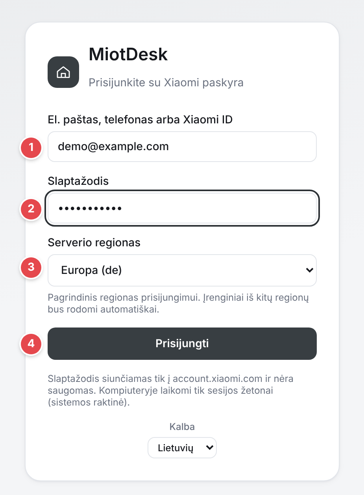 <em>1 pav. Prisijungimo langas su užpildytais laukais</em>

| Nr. | Elementas |
|---|---|
| 1 | **El. paštas, telefonas arba Xiaomi ID** — Xiaomi paskyros prisijungimo vardas, toks pat kaip Mi Home |
| 2 | Xiaomi paskyros **Slaptažodis** |
| 3 | **Serverio regionas** — pagrindinis regionas, pasirinktas Mi Home registruojantis. Kitų regionų įrenginiai randami automatiškai |
| 4 | Mygtukas **Prisijungti** |

1. Jei reikia, lango apačioje sąraše **Kalba** pasirinkite sąsajos kalbą.
2. Įveskite prisijungimo vardą (1) ir slaptažodį (2).
3. Pasirinkite serverio regioną (3). Jei jo nežinote, pasirinkite regioną, kuriame gyvenate; Europai — **Europa (de)**.
4. Spustelėkite **Prisijungti** (4). *Jei Xiaomi neprašo patvirtinimo, atsidaro pagrindinis langas ([7 sk.](#main)).*

> [!NOTE]
> Pirmą kartą prisijungus programa patikrina visus Xiaomi regionus ir įsimena, kur yra jūsų įrenginiai. Vėliau ji kreipiasi tik į tuos regionus. Iš naujo paleidus programą jungtis dar kartą nereikia.

### 6.2 Prisijungimo patvirtinimas (dviejų žingsnių patvirtinimas)

Jungiantis iš naujo įrenginio Xiaomi gali paprašyti patvirtinimo ([2 pav.](#fig-03-login-2fa)).

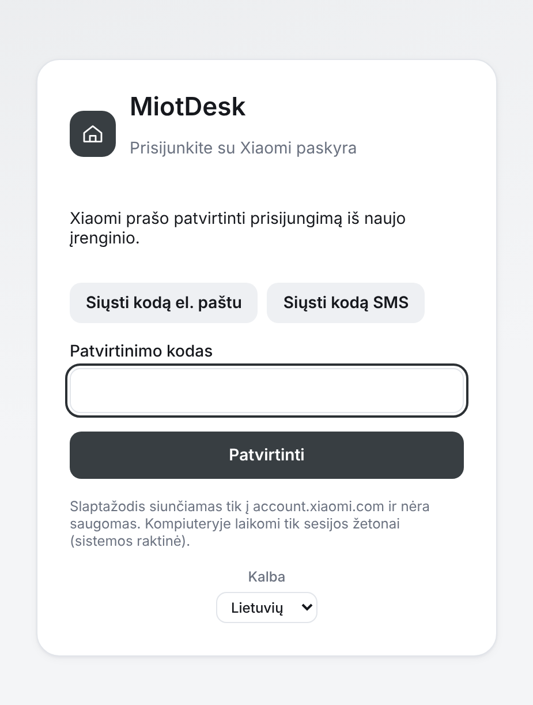 <em>2 pav. Patvirtinimo kodo užklausa</em>

1. Spustelėkite **Siųsti kodą el. paštu** arba **Siųsti kodą SMS**. *Pasirodo pranešimas „Kodas išsiųstas.“*
2. Gautą kodą įveskite į lauką **Patvirtinimo kodas**.
3. Spustelėkite **Patvirtinti**. *Atsidaro pagrindinis langas.*

### 6.3 Jei nepavyksta prisijungti

| Pranešimas / požymis | Ką daryti |
|---|---|
| Neteisingas prisijungimo vardas arba slaptažodis | Patikrinkite klaviatūros kalbą ir slaptažodį, prisijungę prie `account.xiaomi.com` naršyklėje |
| „Xiaomi laikinai reikalauja CAPTCHA“ | Kartą prisijunkite prie `account.xiaomi.com` naršyklėje, tada pakartokite prisijungimą MiotDesk |
| Tinklo klaida | Patikrinkite interneto ryšį. Trumpi sutrikimai kartojami automatiškai (dar 2 bandymai) |
| Tuščias įrenginių sąrašas | Patikrinkite serverio regioną; **Nustatymai → Ryšys** spustelėkite **Iš naujo ieškoti visuose regionuose** |

### 6.4 Atsijungimas

Atidarykite **Nustatymai → Paskyra** ir spustelėkite **Atsijungti**. Sesijos žetonai ir vietinė būsenos kopija pašalinami iš įrenginio.

## 7. Pagrindinis langas

<a href="README.md#main">In English</a>

### 7.1 Pagrindinio lango apžvalga

Prisijungus atsidaro pagrindinis langas su įrenginių sąrašu ([3 pav.](#fig-04-main)).

 <em>3 pav. Pagrindinis langas, „Visi įrenginiai“</em>

| Nr. | Elementas |
|---|---|
| 1 | **Namų pasirinkimas.** Jei paskyroje yra keli namai (įskaitant bendrinamus), čia pasirinkite namus arba „Visi namai“ |
| 2 | **Visi įrenginiai**, **Mėgstamiausi**, **Bendrinami su manimi** (kitų paskyrų su jumis bendrinami įrenginiai). Dešinėje — įrenginių skaičius |
| 3 | Pasirinktų namų **Kambariai** su įrenginių skaičiumi kiekviename |
| 4 | **Ieškoti įrenginio** pagal pavadinimą |
| 5 | **Tvarka** — keisti kortelių tvarką ([9.3 sk.](#order)). Dešiniau — laikas iki kito atnaujinimo ir atnaujinimo mygtukas ⟳ |
| 6 | **Įrenginio kortelė** ([7.2 sk.](#card)) |
| 7 | Programos skyriai: **Namų suvestinė**, **Ryšys**, **Energija**, **Eksploatacinės medžiagos**, **Scenos**, **Tvarkaraščiai**, **Nustatymai** |

Mygtukas **‹** šoninės juostos viršuje ją suskleidžia. Šoninės juostos režimas (pilna, piktogramos, paslėpta) pasirenkamas **Nustatymai → Išdėstymas**.

Atnaujinimo laikmatis rodo laiką iki kitos būsenos užklausos; atnaujinant rodoma „…“, sustabdžius užklausas — „⏸“. Mygtuką ⟳ galima spausti ne dažniau kaip kas 15 sekundžių.

### 7.2 Įrenginio kortelė

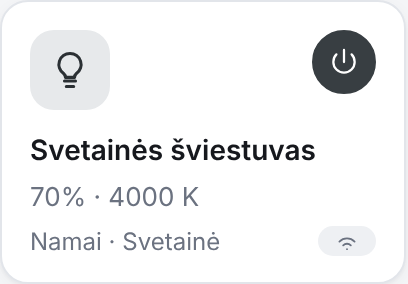 <em>4 pav. Įrenginio kortelė</em>

Kortelėje ([4 pav.](#fig-05-card)) rodoma:

- įrenginio piktograma (viršuje kairėje) — automatinė arba jūsų pasirinkta;
- maitinimo mygtukas ⏻ (viršuje dešinėje): tamsus — įjungta, šviesus — išjungta. Keliaklavišiai jungikliai vietoje jo rodo sunumeruotus klavišų mygtukus, o po kiekvienu mygtuku — klavišo pavadinimą (savą, iš Mi Home arba „Klavišas N“; ilgas pavadinimas sutrumpinamas, visas matomas užvedus pelę);
- pavadinimas, trumpa būsena (pvz., „70% · 4000 K“) ir vieta „Namai · Kambarys“;
- ryšio kelio piktograma apačioje dešinėje: Wi-Fi — vietinis tinklas, debesis — per Xiaomi debesį;
- spalvoti taškai virš maitinimo mygtuko — priskirtos žymos ([10 sk.](#tags)); jutikliuose — baterijos lygis.

Nepasiekiamas įrenginys rodomas pritemdyta, neaktyvia kortele. Spustelėjus kortelę (bet kur, išskyrus maitinimo mygtuką) atsidaro įrenginio langas.

### 7.3 Vaizdas telefone

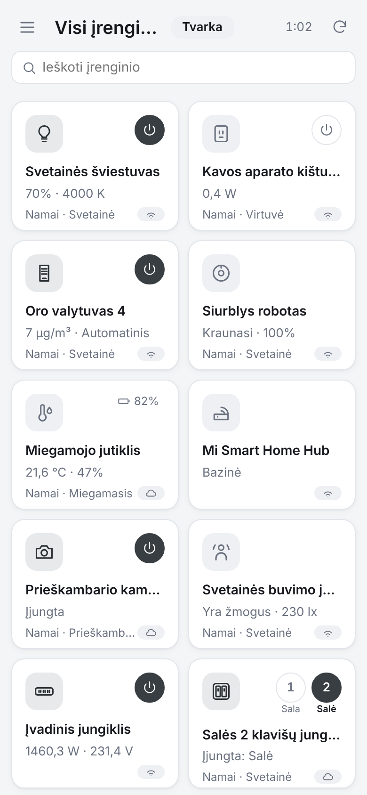 <em>5 pav. Pagrindinis ekranas telefone</em>

Telefone ([5 pav.](#fig-39-mobile)) šoninė juosta atidaroma mygtuku ☰ viršutiniame kairiajame kampe, o įrenginio langas užima visą ekraną. Visi kiti elementai ir veiksmai tokie patys kaip kompiuteryje.

### 7.4 Veikimas fone

Uždarius langą kompiuteryje programa neišsijungia, o pasislepia pranešimų srityje (dėkle); atnaujinimas, pranešimai, tvarkaraščiai ir laikmačiai toliau veikia. Dėklo piktogramos meniu yra **Atidaryti MiotDesk**, **Mėgstamiausi** (su įjungimu), **Scenos** ir **Išeiti**. macOS sistemoje langas grąžinamas spustelėjus piktogramą Dock juostoje.

## 8. Įrenginio langas

<a href="README.md#device">In English</a>

### 8.1 Įrenginio lango antraštė

Spustelėkite kortelę — dešinėje atsidaro įrenginio langas. Jo antraštėje ([6 pav.](#fig-37-panel-head)) yra:

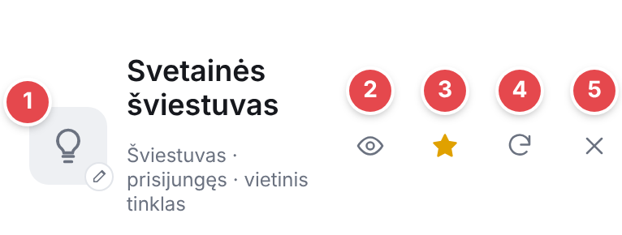 <em>6 pav. Įrenginio lango antraštė</em>

| Nr. | Elementas |
|---|---|
| 1 | **Piktograma.** Spustelėkite ir pasirinkite piktogramą (apie 50 variantų arba savą paveikslėlį) bei kortelės dydį: mažą, vidutinį, didelį |
| 2 | **Slėpti sąrašuose** (akies piktograma) — įrenginys dingsta iš kambarių ir „Visi įrenginiai“. Pranešimai, mėgstamiausi ir grupės toliau veikia. Įrankių juostos mygtukas **Paslėpti: N** laikinai parodo paslėptus įrenginius |
| 3 | **Į mėgstamiausius** ☆ ([9 sk.](#fav)) |
| 4 | **Atnaujinti** šio įrenginio būseną |
| 5 | **Uždaryti** įrenginio langą |

Po pavadinimu: įrenginio tipas, ryšio būsena („prisijungęs“) ir kelias („vietinis tinklas“ arba „debesis“).

### 8.2 Įrenginio valdymas

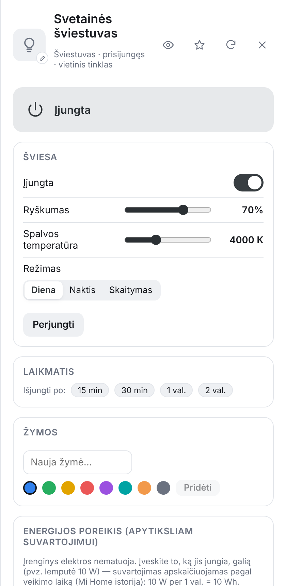 <em>7 pav. Šviestuvo langas</em>

Įrenginio langas sudaromas automatiškai pagal oficialų modelio aprašą (MIoT specifikaciją). Šviestuvo pavyzdys — [7 pav.](#fig-06-panel-light):

- didelis mygtukas viršuje (**Įjungta** / **Išjungta**) perjungia maitinimą;
- jungikliai, slankikliai (ryškumas, spalvos temperatūra) ir mygtukų rinkiniai (režimas) keičia atitinkamus parametrus;
- veiksmų mygtukai (pvz., **Perjungti**) vykdo įrenginio komandą.

Pakeitimai siunčiami iš karto. Ką tik nustatytos reikšmės apsaugotos nuo „atšokimo“: jūsų reikšmė lieka ekrane, kol įrenginys ją patvirtina.

> [!NOTE]
> Nepasiekiamam įrenginiui rodomos paskutinės žinomos reikšmės (tik skaityti) su paskutinio pasikeitimo laiku.

### 8.3 Greitasis laikmatis

 <em>8 pav. Blokas „Laikmatis“</em>

Įrenginiai su maitinimo mygtuku turi bloką **Laikmatis** ([8 pav.](#fig-07-panel-timer)): spustelėkite **15 min**, **30 min**, **1 val.** arba **2 val.** Įjungtas įrenginys po pasirinkto laiko bus išjungtas, išjungtas — įjungtas. Vykdymo laikas rodomas bloke, laikmatį galima atšaukti. Visi laikmačiai taip pat matomi skyriuje **Tvarkaraščiai** ([12.1 sk.](#schedules)).

### 8.4 Jutikliai ir pranešimų ribos

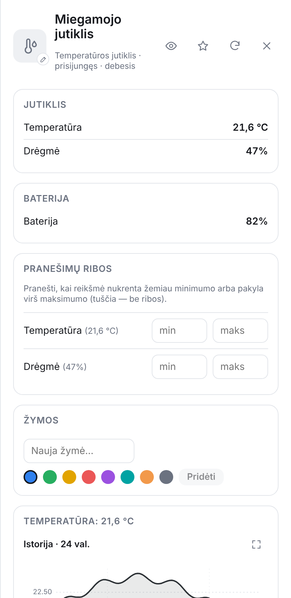 <em>9 pav. Temperatūros ir drėgmės jutiklio langas</em>

Jutiklio lange ([9 pav.](#fig-08-panel-sensor)) rodomi dabartiniai rodmenys, baterijos lygis ir istorijos grafikai. Bloke **Pranešimų ribos** galite nustatyti temperatūros, drėgmės, CO₂ ir KD2,5 (PM2.5) **min** ir (arba) **maks** reikšmes. Reikšmei peržengus ribą gausite pranešimą, pvz., „Temperatūra 27,4 °C — virš 26 °C“. Jis kartojamas tik reikšmei grįžus į normą. Tuščias laukas reiškia, kad ribos nėra.

### 8.5 Istorijos grafikai

Jutiklio lango apačioje rodomas 24 valandų grafikas. Padidinimo mygtukas jo viršutiniame dešiniajame kampe atidaro grafiką atskirame lange ([10 pav.](#fig-09-chart-window)).

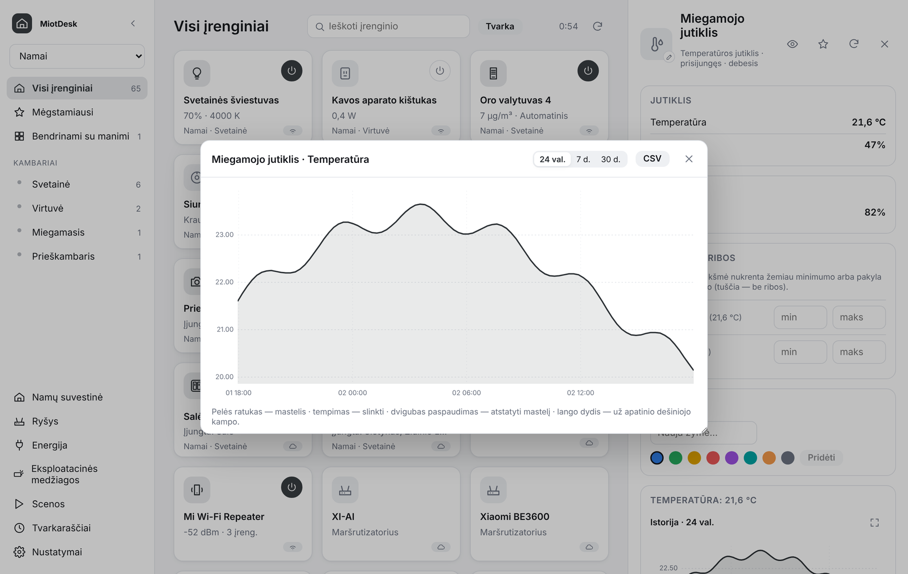 <em>10 pav. Istorijos grafiko langas</em>

- Laikotarpis: **24 val.**, **7 d.**, **30 d.**
- Pelės ratukas — mastelis, tempimas — poslinkis, dvigubas spustelėjimas — mastelio atkūrimas; lango dydis keičiamas tempiant apatinį dešinįjį kampą.
- Reikšmė taške rodoma užvedus ant jo pelę.
- Paskutinis grafiko taškas — dabartinė reikšmė: Xiaomi debesis istoriją įrašo su vėlavimu.
- **CSV** — išsaugoti duomenis į failą Excel programai (aplanke „Atsisiuntimai“).
- Langas uždaromas ✕ arba klavišu Esc.

### 8.6 Siurblys robotas

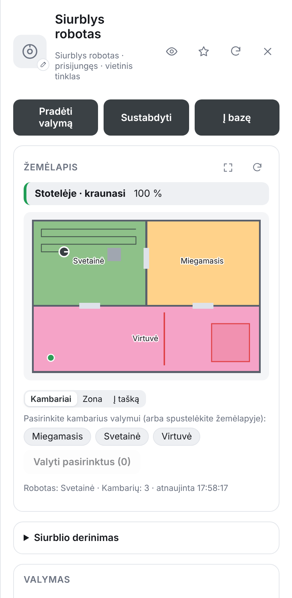 <em>11 pav. Siurblio roboto langas</em>

Siurbliams robotams ([11 pav.](#fig-38-vacuum)) viršuje rodomi mygtukai **Pradėti valymą**, **Sustabdyti**, **Į bazę**. Blokas **Žemėlapis** rodo būseną (pvz., „Stotelėje · kraunasi 100 %“), roboto padėtį ir kambarius. Žemėlapio režimai:

- **Kambariai** — pasirinkite kambarius mygtukais po žemėlapiu arba spustelėdami žemėlapį, tada spustelėkite **Valyti pasirinktus**;
- **Zona** — žemėlapyje nutempkite stačiakampį;
- **Į tašką** — spustelėkite žemėlapį, robotas nuvažiuos ten.

„Zona“ ir „Į tašką“ veikia Roborock ir Dreame robotams (įskaitant Dreame gamybos Xiaomi robotus). Žemiau — valymo parametrai (siurbimo galia ir kt.).

Valymo metu žemėlapis atnaujinamas kas 20 sekundžių. Dreame robotams (įskaitant Dreame gamybos Xiaomi, pvz., X20+) roboto padėtis, stotelė ir valymo kelias imami iš duomenų, kuriuos robotas valymo metu siunčia į debesį.

### 8.7 Siurblio derinimas

Jei valymo metu žemėlapis vis tiek rodo robotą ne ten, kur jis yra (pvz., prie stotelės), po žemėlapiu yra išskleidžiamas blokas **Siurblio derinimas** ([12 pav.](#fig-39-vacdebug)). Jis surenka ataskaitą kūrėjui: žemėlapio savybes, jų istoriją Xiaomi debesyje per paskutines 3 valandas ir roboto bei stotelės padėtį dabartiniame žemėlapyje.

1. Paleiskite valymą ir atidarykite siurblio langą.
2. Išskleiskite **Siurblio derinimas** ir spustelėkite **Surinkti** arba **Surinkti + paprašyti žemėlapio**. *Antrasis variantas dar paprašo siurblio įkelti dabartinį žemėlapį (kaip Mi Home atidarius žemėlapį) ir po 6 sekundžių patikrina dar kartą. Surinkimas trunka iki minutės.*
3. Spustelėkite **Kopijuoti** arba **Išsaugoti į failą** ir nusiųskite ataskaitą kūrėjui.

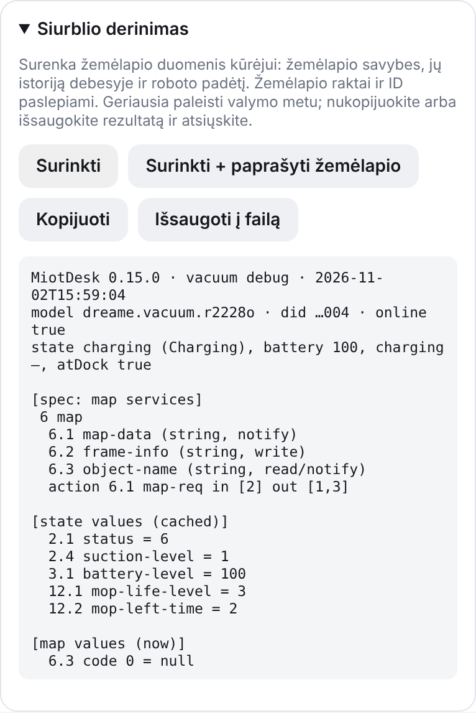 <em>12 pav. Blokas „Siurblio derinimas“ su ataskaita</em>

> [!NOTE]
> Ataskaitoje nėra žemėlapio raktų (rodomas tik jų ilgis) ir pilnų naudotojo ar įrenginio ID. Ji niekur nesiunčiama automatiškai.

## 9. Mėgstamiausi, grupės ir kortelių tvarka

<a href="README.md#fav">In English</a>

### 9.1 Įtraukimas į mėgstamiausius

1. Atidarykite įrenginio langą.
2. Spustelėkite žvaigždutę ☆ šalia pavadinimo ([13 pav.](#fig-10-star)). *Žvaigždutė tampa užpildyta; įrenginys atsiranda skyriuje „Mėgstamiausi“ ir dėklo meniu.*

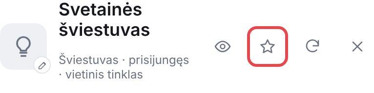 <em>13 pav. Mygtukas „Į mėgstamiausius“</em>

Spustelėjus dar kartą, įrenginys pašalinamas iš mėgstamiausių.

### 9.2 Grupės

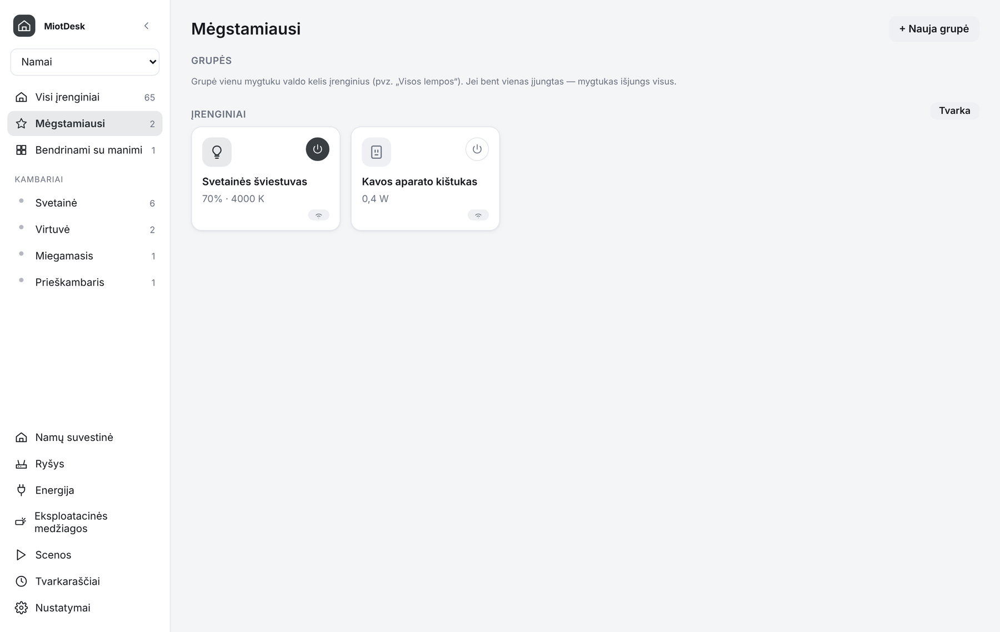 <em>14 pav. Mėgstamiausi</em>

Grupė vienu mygtuku perjungia kelis įrenginius (pvz., „Visos lempos“). Jei įjungtas bent vienas grupės įrenginys, mygtukas juos visus išjungia.

1. Atidarykite **Mėgstamiausi** ([14 pav.](#fig-11-favorites)) ir spustelėkite **+ Nauja grupė**.
2. Įveskite **Grupės pavadinimas** ir pažymėkite **Grupės įrenginiai**.
3. Spustelėkite **Išsaugoti**.

Grupę galima pakeisti (**Keisti**) arba ištrinti (**Ištrinti** → patvirtinti). Grupės mygtukas rodo, kiek įrenginių įjungta, pvz., „Įjungta 2 iš 3“.

### 9.3 Kortelių tvarkos keitimas

1. Atidarykite sąrašą (kambarį, „Visi įrenginiai“ arba „Mėgstamiausi“).
2. Įrankių juostoje spustelėkite **Tvarka**. *Kortelėse atsiranda rodyklės ◀ ▶ ([15 pav.](#fig-12-order)).*
3. Perkelkite korteles rodyklėmis arba nutempkite pele.
4. Spustelėkite **Baigta**.

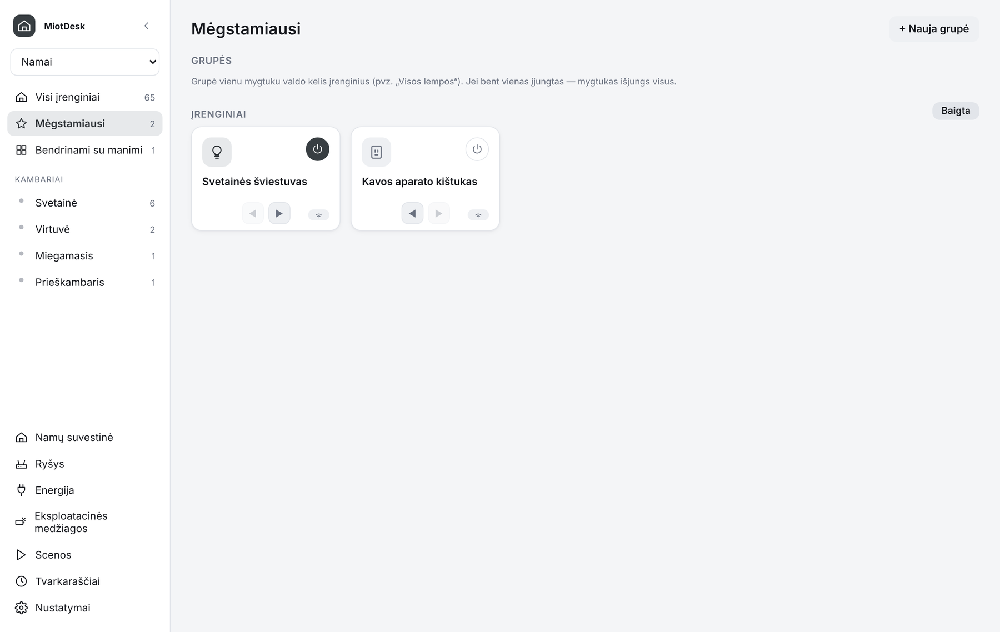 <em>15 pav. Tvarkos keitimo režimas</em>

Tvarka išsaugoma atskirai kiekvienam kambariui; nauji įrenginiai pridedami pabaigoje. Pradinė tvarka atkuriama mygtuku **Atkurti numatytą kortelių tvarką** skyriuje **Nustatymai** (blokas „Kortelių tvarka ir paslėpti įrenginiai“), kuriame taip pat išvardyti paslėpti įrenginiai.

## 10. Žymos

<a href="README.md#tags">In English</a>

Žymos — jūsų pačių spalvotos įrenginių etiketės (pvz., „Šviesa“, „Svetainė — vakaras“). Įrenginys gali turėti kelias žymas. Žymos rodomos kortelėse spalvotais taškais ir leidžia filtruoti sąrašą.

### 10.1 Žymos sukūrimas

1. Atidarykite bet kurio įrenginio langą ir raskite bloką **Žymos** ([16 pav.](#fig-13-tags-empty)).
2. Lauke **Nauja žymė…** (1) įveskite pavadinimą.
3. Pasirinkite vieną iš aštuonių spalvų (2) (pasirinkta spalva apvesta).
4. Spustelėkite **Pridėti**. *Žyma sukuriama ir iš karto priskiriama šiam įrenginiui ([18 pav.](#fig-15-tags-assigned)).*

 <em>16 pav. Blokas „Žymos“ — žymų dar nėra</em>

 <em>17 pav. Pavadinimo įvedimas ir spalvos pasirinkimas</em>

### 10.2 Žymos priskyrimas ir nuėmimas

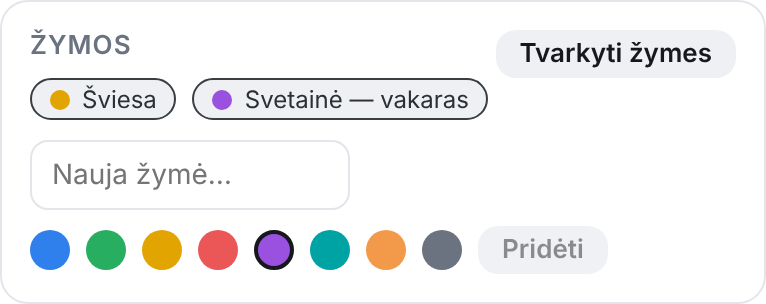 <em>18 pav. Įrenginiui priskirtos žymos</em>

Esamos žymos bloke **Žymos** rodomos mygtukais. Priskirta žyma turi kontūrą.

1. Atidarykite įrenginio langą.
2. Spustelėkite žymos mygtuką. *Nepriskirta žyma priskiriama, priskirta — nuimama.*

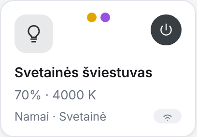 <em>19 pav. Žymų taškai kortelėje</em>

Priskirtos žymos įrenginio kortelėje rodomos spalvotais taškais ([19 pav.](#fig-16-tag-dots)).

### 10.3 Filtravimas pagal žymą

Kai yra bent viena žyma, virš įrenginių sąrašo atsiranda filtro eilutė ([20 pav.](#fig-17-tag-filter)).

 <em>20 pav. Žymų filtro eilutė</em>

1. Spustelėkite žymą. *Sąraše lieka tik įrenginiai su šia žyma ([21 pav.](#fig-18-tag-filtered)).*
2. Norėdami panaikinti filtrą, spustelėkite **Visi** arba dar kartą pasirinktą žymą.

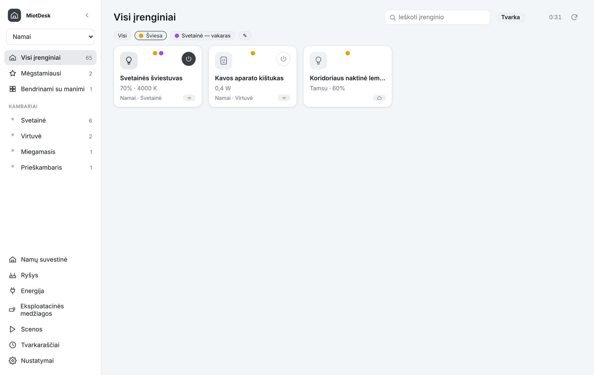 <em>21 pav. Sąrašas, filtruotas pagal žymą „Šviesa“</em>

Mygtukas ✎ filtro eilutės gale atidaro žymų tvarkymą ([10.4 sk.](#tag-edit)).

### 10.4 Pervadinimas ir spalvos keitimas

Žymų tvarkymą galima atidaryti trimis būdais:

- mygtuku **Tvarkyti žymes** įrenginio lango bloke „Žymos“;
- mygtuku ✎ filtro eilutėje;
- **Nustatymai → Žymos** ([13.7 sk.](#set-tags)).

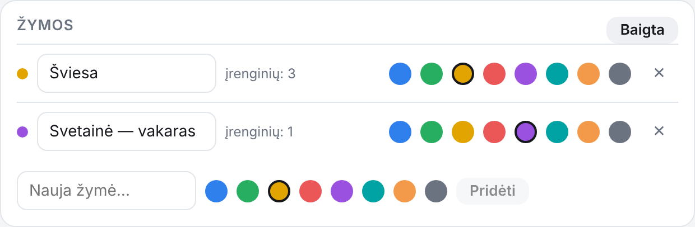 <em>22 pav. Žymų tvarkymas</em>

Sąraše ([22 pav.](#fig-19-tags-manage)) rodomas kiekvienos žymos pavadinimas, įrenginių skaičius ir spalva.

1. Norėdami pervadinti žymą, pakeiskite tekstą jos pavadinimo lauke.
2. Norėdami pakeisti spalvą, žymos eilutėje spustelėkite kitą spalvos apskritimą.
3. Spustelėkite **Baigta**. *Pakeitimai iš karto matomi visose kortelėse ir filtre.*

Čia taip pat galima sukurti naują žymą — apatinėje eilutėje (**Nauja žymė…** → spalva → **Pridėti**).

### 10.5 Žymos ištrynimas

> [!IMPORTANT]
> Ištrinta žyma nuimama nuo visų įrenginių. Ištrynimo atšaukti negalima — žymą tektų sukurti ir priskirti iš naujo.

1. Atidarykite žymų tvarkymą ([10.4 sk.](#tag-edit)).
2. Žymos eilutėje spustelėkite ✕. *Vietoje kryžiuko atsiranda patvirtinimo mygtukas su įrenginių skaičiumi, pvz., „Ištrinti (bus nuimta nuo 1 įr.)“ ([23 pav.](#fig-19b-tags-delete)).*
3. Spustelėkite patvirtinimo mygtuką. *Žyma ištrinama ir nuimama nuo visų įrenginių.* Jei persigalvojote, jo nespauskite ir spustelėkite **Baigta**.

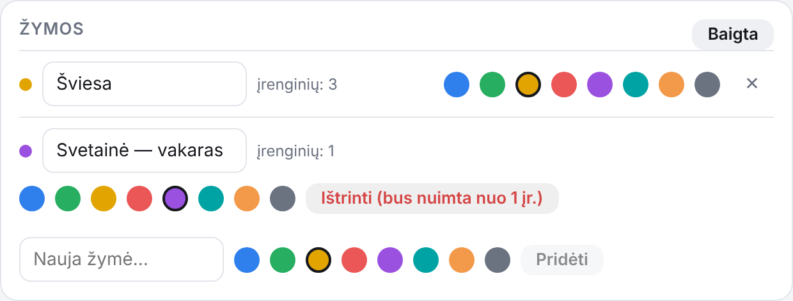 <em>23 pav. Žymos ištrynimo patvirtinimas</em>

> [!NOTE]
> Norėdami nuimti žymą tik nuo vieno įrenginio, jos netrinkite — spustelėkite jos mygtuką įrenginio lange ([10.2 sk.](#tag-assign)).

## 11. Elektros suvartojimas

<a href="README.md#energy">In English</a>

MiotDesk rodo elektros suvartojimą dviem būdais:

- **išmatuotą** — įrenginiams su įmontuotu matuokliu (išmanieji kištukiniai lizdai, automatiniai jungikliai, kai kurie jungikliai), iš Mi Home statistikos;
- **apytikslį** — įrenginiams be matuoklio (lempos, jungikliai, drėkintuvai, siurblio stotelė): skaičiuojamas pagal jūsų įvestą galią ir veikimo laiką.

### 11.1 Įrenginiai su matuokliu

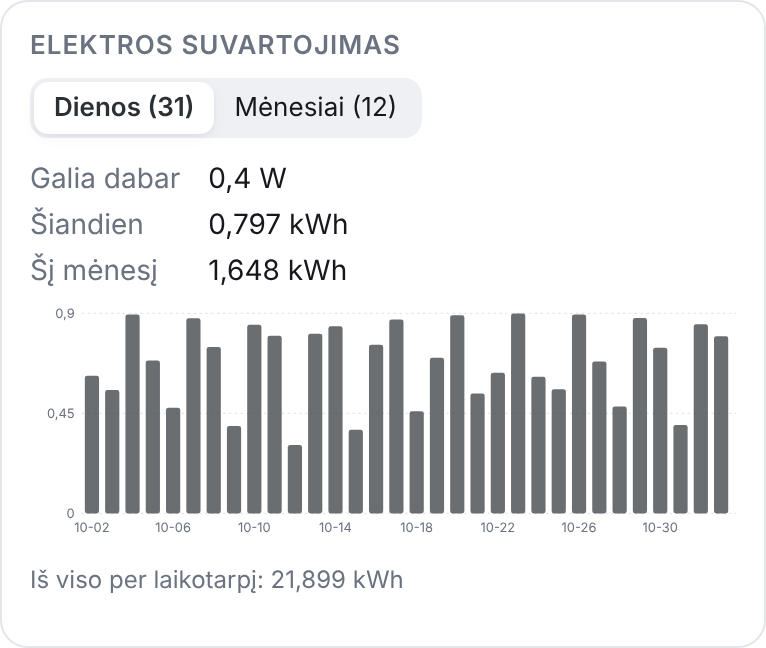 <em>24 pav. Kištukinio lizdo blokas „Elektros suvartojimas“</em>

Tokio įrenginio lange yra blokas **Elektros suvartojimas** ([24 pav.](#fig-20-energy-plug)): **Galia dabar**, suvartojimas **Šiandien** ir **Šį mėnesį**, grafikas pagal **Dienos (31)** arba **Mėnesiai (12)** ir **Iš viso per laikotarpį**.

### 11.2 Skyrius „Energija“

Šoninės juostos skyrius **Energija** ([25 pav.](#fig-21-energy-summary)) sumuoja visus įrenginius, kurie praneša suvartojimą Mi Home:

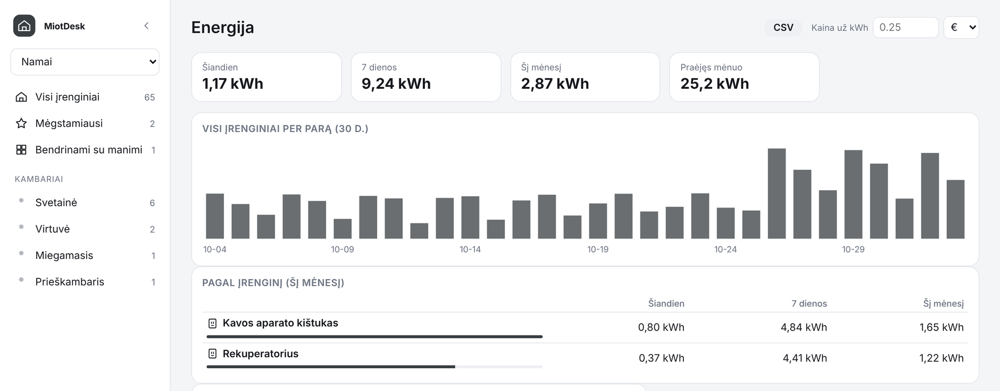 <em>25 pav. Skyrius „Energija“</em>

- plytelės **Šiandien**, **7 dienos**, **Šį mėnesį**, **Praėjęs mėnuo**;
- grafikas **Visi įrenginiai per parą (30 d.)**;
- lentelė **Pagal įrenginį (šį mėnesį)** su stulpeliais „Šiandien“, „7 dienos“, „Šį mėnesį“;
- laukas **Kaina už kWh** ir valiuta — užpildžius, šalia sumų rodoma kaina;
- mygtukas **CSV** — išsaugoti duomenis į failą.

> [!NOTE]
> Statistika įkeliama tik atidarius skyrių, po vieną įrenginį, ir laikoma 30 minučių. Taip išvengiama nereikalingų užklausų Xiaomi. Kaina saugoma tik šiame įrenginyje.

### 11.3 Įrenginio be matuoklio pridėjimas

Įrenginiams, kurie patys nematuoja elektros, galite įvesti prijungtos apkrovos galią. Suvartojimas skaičiuojamas taip:

**Suvartojimas (Wh) = Galia (W) × Įjungimo laikas (h)**

Pavyzdžiui, 10 W lempa, įjungta 1 valandą, suvartoja 10 Wh. Veikimo laikas imamas iš Mi Home būsenų istorijos.

1. Atidarykite skyrių **Energija**.
2. Bloke **Pridėti įrenginį be matuoklio** atidarykite **Pasirinkite įrenginį…** ir pasirinkite įrenginį ([26 pav.](#fig-25-est-add)). *Atsidaro įrenginio langas.* Įrenginio langą galima atidaryti ir iš įrenginių sąrašo.
3. Raskite bloką **Energijos poreikis (apytiksliam suvartojimui)** ([27 pav.](#fig-22-est-empty)).
4. Lauke **Galia įjungus** įveskite to, ką įrenginys įjungia, galią vatais (iš lempos žymėjimo ar instrukcijos). Kelių kanalų jungikliui galia įvedama kiekvienam kanalui.
5. Patikrinkite rezultatą. *Po lauku atsiranda skaičiavimas, pvz., „Apytiksliai: šiandien 1,029 kWh, šį mėnesį 1,029 kWh“ ([28 pav.](#fig-23-est-filled)).*

 <em>26 pav. Blokas „Pridėti įrenginį be matuoklio“</em>

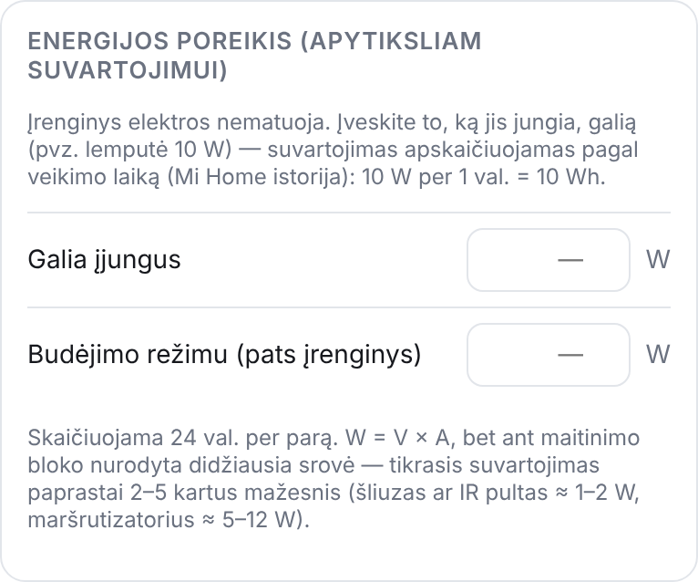 <em>27 pav. Galia dar neįvesta</em>

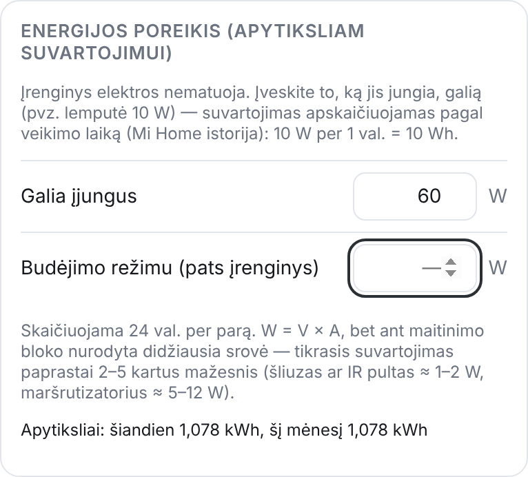 <em>28 pav. Galia įvesta — rodomas skaičiavimas</em>

Norėdami įrenginį pašalinti iš skaičiavimo, išvalykite galios lauką.

**Siurblio stotelė.** Stotelei įvedamos trys vertės iš instrukcijos: **Kraunant**, **Ramybės metu** (robotas įkrautas arba valo) ir pasirinktinai **Stotelė plauna / džiovina**. Laikas kiekviename režime imamas iš roboto būsenų istorijos.

**Nuolat į lizdą įjungti įrenginiai.** Šliuzai, kartotuvai, IR pultai, maršrutizatoriai, kameros ir kiti iš tinklo maitinami įrenginiai taip pat vartoja elektrą. Jų lange yra laukas **Nuolat (įjungtas į lizdą)**, W (jungikliams — **Budėjimo režimu (pats įrenginys)**); suvartojimas skaičiuojamas 24 valandas per parą. Galią galima įvertinti kaip V × A, bet ant maitinimo bloko nurodyta didžiausia srovė — tikrasis suvartojimas paprastai 2–5 kartus mažesnis (šliuzas ar IR pultas ≈ 1–2 W, maršrutizatorius ≈ 5–12 W). Baterijomis maitinami jutikliai šio lauko neturi.

### 11.4 Kaip rodomas apytikslis suvartojimas

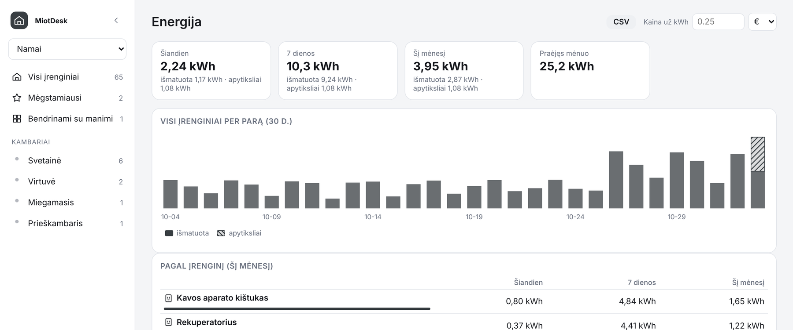 <em>29 pav. „Energija“ su įrenginiu be matuoklio</em>

Įvedus galią, įrenginys įskaičiuojamas skyriuje **Energija** ([29 pav.](#fig-24-energy-summary-est)):

- lentelėje pagal įrenginius jis pažymėtas **≈ apytiksliai**;
- kiekvienoje plytelėje po suma atskira eilute rodoma „išmatuota … · apytiksliai …“; suma apima abi dalis;
- grafike apytikslė dalis — **brūkšniuota** viršutinė to paties pločio vientiso (išmatuoto) stulpelio dalis; legendoje po grafiku — „išmatuota“ ir „apytiksliai“;
- apytikslis suvartojimas įtraukiamas į sumas ir kainą.

### 11.5 Tikslumas

> [!IMPORTANT]
> Apytikslis suvartojimas yra įvertis, ne matavimas. Jo tikslumas priklauso nuo jūsų įvestos galios ir Mi Home istorijos išsamumo. Programa niekada neįrašo numatytosios galios: reikšmę visada įveda naudotojas.

Jei šios dienos būsenų istorijos dar nėra, šios dienos suvartojimas skaičiuojamas nuo vidurnakčio pagal dabartinę įrenginio būseną.

## 12. Kiti skyriai

<a href="README.md#sections">In English</a>

### 12.1 Tvarkaraščiai ir laikmačiai

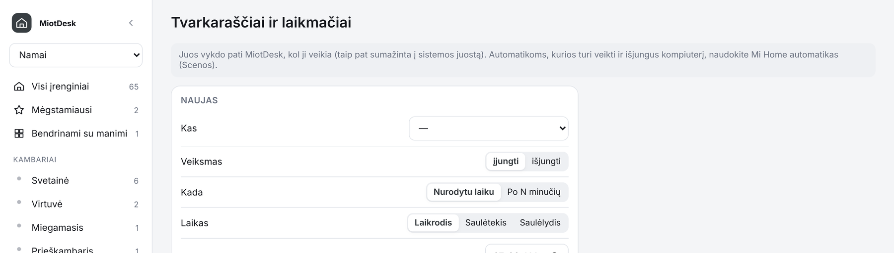 <em>30 pav. „Tvarkaraščiai ir laikmačiai“</em>

Šiame skyriuje ([30 pav.](#fig-26-schedules)) įrenginiai ir grupės įjungiami ir išjungiami arba paleidžiamos scenos nustatytu laiku.

1. Bloke **Naujas** lauke **Kas** pasirinkite įrenginį, grupę ar sceną.
2. Pasirinkite **Veiksmas**: **įjungti** arba **išjungti**.
3. Lauke **Kada** pasirinkite **Nurodytu laiku** arba **Po N minučių** (laikmatis).
4. Nustatytam laikui pasirinkite **Laikrodis**, **Saulėtekis** arba **Saulėlydis** (su poslinkiu nuo −240 iki +240 minučių), nustatykite laiką ir savaitės dienas. Nepasirinkus dienų tvarkaraštis įvykdomas vieną kartą.
5. Spustelėkite **Pridėti**.

> [!IMPORTANT]
> Tvarkaraščius vykdo pati MiotDesk, kol ji veikia. Jei programa buvo uždaryta arba kompiuteris miegojo, veiksmas įvykdomas tik tada, jei vėluoja ne daugiau kaip 3 minutes. Automatizacijoms, kurios turi veikti išjungus kompiuterį, naudokite Mi Home scenas.

Saulėtekiui ir saulėlydžiui vieną kartą įveskite koordinates (platumą, ilgumą); jos saugomos tik įrenginyje. Paskutinių vykdymų žurnalas — skyriaus apačioje.

### 12.2 Eksploatacinės medžiagos

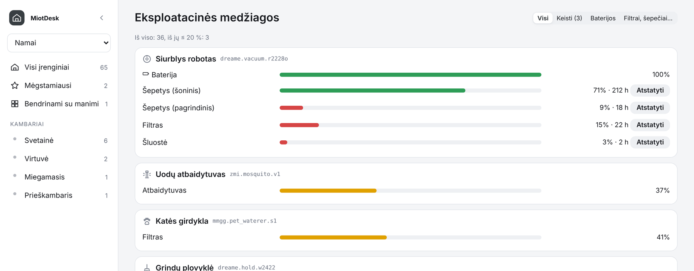 <em>31 pav. „Eksploatacinės medžiagos“</em>

Šiame skyriuje ([31 pav.](#fig-27-consumables)) rodomas filtrų, šepečių, šluosčių likęs resursas ir visų įrenginių baterijų lygis. Juostos spalva: žalia — gerai, geltona — netrukus keisti, raudona — keisti dabar. **Atstatyti** atstato skaitiklį pakeitus dalį. Filtrai viršuje dešinėje: **Visi**, **Keisti**, **Baterijos**, **Filtrai, šepečiai…**.

### 12.3 Scenos ir automatizacijos

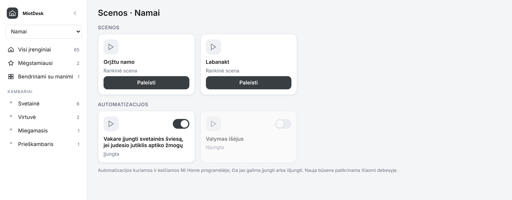 <em>32 pav. „Scenos“</em>

Šiame skyriuje ([32 pav.](#fig-28-scenes)) rankinės Mi Home scenos paleidžiamos mygtuku **Vykdyti**. Automatizacijas galima įjungti ir išjungti; nauja būsena dar kartą patikrinama Xiaomi debesyje. Automatizacijos kuriamos ir keičiamos tik Mi Home.

### 12.4 Namų suvestinė

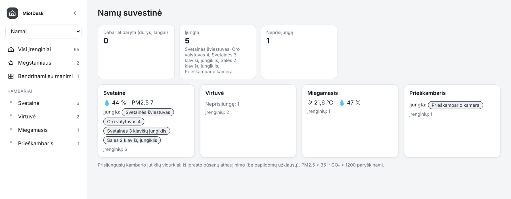 <em>33 pav. „Namų suvestinė“</em>

Šiame skyriuje ([33 pav.](#fig-29-overview)) rodoma suvestinė: atidarytos durys ir langai, įjungti įrenginiai, neprisijungę įrenginiai ir vidutiniai jutiklių rodmenys pagal kambarius. KD2,5 virš 35 ir CO₂ virš 1200 paryškinami.

### 12.5 Ryšys

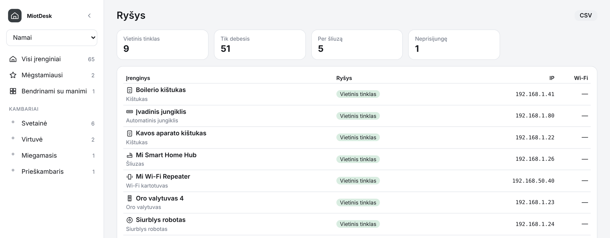 <em>34 pav. „Ryšys“</em>

Šiame skyriuje ([34 pav.](#fig-30-connectivity)) rodomas kiekvieno įrenginio ryšio kelias: **Vietinis tinklas**, **Tik debesis**, **Per šliuzą**, taip pat IP adresas, Wi-Fi signalas ir neprisijungę įrenginiai. Lentelę galima rikiuoti ir išsaugoti mygtuku **CSV**.

## 13. Nustatymai

<a href="README.md#settings">In English</a>

Skyriuje **Nustatymai** ([35 pav.](#fig-31-settings)) yra: Kalba, Akcento spalva, Prieinamumas, Išdėstymas, Pranešimai, Ryšys, Klaidų žurnalas, Darbalaukio valdiklis (Windows, macOS ir Android), Žymos, Kortelių tvarka ir paslėpti įrenginiai, Atsarginė kopija, Paskyra, Apie.

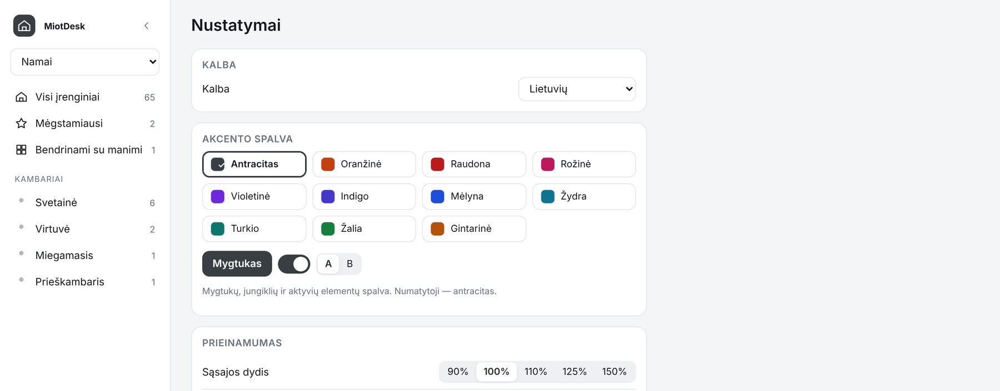 <em>35 pav. „Nustatymai“, viršutinė dalis</em>

### 13.1 Kalba, spalva ir prieinamumas

- **Kalba** — anglų, rusų arba lietuvių.
- **Akcento spalva** — mygtukų, jungiklių ir aktyvių elementų spalva: antracito (numatyta) ir dar 10 spalvų. Šviesi ir tamsi temos parenkamos pagal sistemos nustatymą.
- **Prieinamumas** — **Sąsajos dydis** 90–150 % (taip pat Ctrl + / Ctrl − / Ctrl 0) ir **Didelis kontrastas**.

### 13.2 Išdėstymas

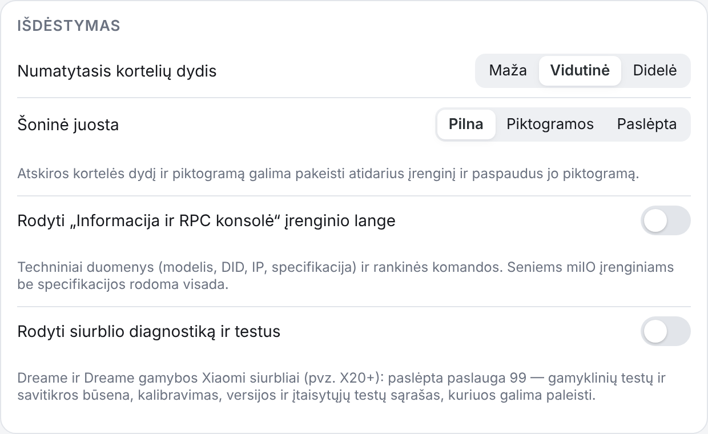 <em>36 pav. Blokas „Išdėstymas“</em>

- **Numatytasis kortelių dydis**: Maža, Vidutinė, Didelė. Vienos kortelės dydis keičiamas įrenginio lange spustelėjus jos piktogramą.
- **Šoninė juosta**: Pilna, Piktogramos, Paslėpta.
- **Rodyti „Informacija ir RPC konsolė“ įrenginio lange** — techniniai duomenys (modelis, DID, IP, specifikacija) ir rankinės komandos. Patyrusiems naudotojams.
- **Rodyti siurblio diagnostiką ir testus** — Dreame robotų tarnybinė informacija.

### 13.3 Pranešimai

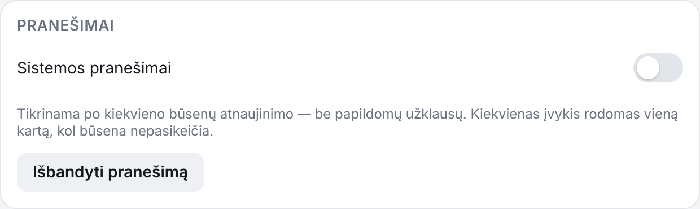 <em>37 pav. Blokas „Pranešimai“</em>

Įjunkite **Sistemos pranešimai** ir patikrinkite mygtuku **Išbandyti pranešimą**. Pranešimai vertinami po kiekvieno būsenos atnaujinimo, be papildomų užklausų; kiekvienas įvykis rodomas vieną kartą, kol būsena pasikeičia. Pranešimų tipai (baterija, eksploatacinės medžiagos, nuotėkis, dūmai ir dujos, atidarytos durys, roboto klaidos, įrenginys atsijungė, dingo internetas, temperatūros ir oro kokybės ribos) įjungiami atskirai.

### 13.4 Ryšys

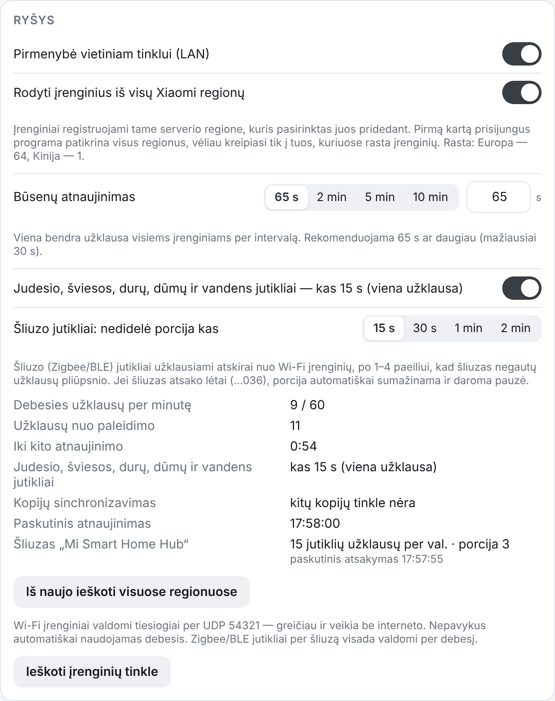 <em>38 pav. Blokas „Ryšys“</em>

| Parametras | Aprašymas |
|---|---|
| **Pirmenybė vietiniam tinklui (LAN)** | Valdyti Wi-Fi įrenginius tiesiogiai (UDP 54321). Rekomenduojama palikti įjungtą |
| **Rodyti įrenginius iš visų Xiaomi regionų** | Sujungti visų regionų įrenginius. Žemiau rodomas kiekviename regione rastų įrenginių skaičius |
| **Būsenų atnaujinimas** | 65 s (rekomenduojama), 2, 5, 10 min arba sava reikšmė, ne mažiau kaip 30 s |
| **Judesio, šviesos, durų, dūmų ir vandens jutikliai — kas 15 s (viena užklausa)** | Greitas šių jutiklių atnaujinimas viena užklausa |
| **Šliuzo jutikliai: nedidelė porcija kas** | 15 s (numatyta), 30 s, 1 arba 2 min. Šliuzo (Zigbee/BLE) jutikliai užklausiami atskirai nuo Wi-Fi įrenginių, po 1–4 paeiliui, todėl šliuzas niekada negauna užklausų pliūpsnio. Jei jis atsako lėtai (…036), porcija automatiškai sumažinama ir daroma pauzė. Jei neatsako vienas įrenginys (išsikrovusi baterija, per toli nuo šliuzo), o kiti atsako, 10 minučių praleidžiamas tik jis — šliuzo tempas nemažinamas. Jei šliuzas neatsako net su 1 įrenginiu užklausoje, jutikliai skaitomi iš jų pranešimų Xiaomi debesyje (šliuzui užklausų nėra); kas 5 minutes šliuzas patikrinamas ir po 2 sėkmingų patikrų jutikliai vėl skaitomi tiesiogiai |
| Užklausų statistika | Užklausos debesiui per minutę, nuo paleidimo, laikas iki kito atnaujinimo, kopijų sinchronizavimo būsena ([14 sk.](#sync)), nepasiekiami Xiaomi regionai; kiekvienam šliuzui — jutiklių užklausos per valandą, porcijos dydis, pauzė ir paskutinis geras atsakymas (arba „neveikia nuo …“) |
| **Iš naujo ieškoti visuose regionuose** | Dar kartą ieškoti įrenginių, pvz., įrenginiui persikėlus į kitą regioną |
| **Ieškoti įrenginių tinkle** | Ieškoti Wi-Fi įrenginių vietiniame tinkle |

### 13.5 Klaidų žurnalas

Bloke **Klaidų žurnalas** kaupiamos programos šiame įrenginyje pastebėtos problemos: nepavykę veiksmai, nepasiekiami Xiaomi serveriai, kopijų sinchronizavimo sutrikimai, neįvykdyti tvarkaraščiai ir pan. Žurnalas nedaro papildomų užklausų Xiaomi ir saugomas tik šiame įrenginyje.

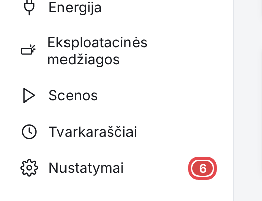 <em>39 pav. Naujų klaidų skaičius šalia „Nustatymai“</em>

Atsiradus naujoms klaidoms ar įspėjimams, jų skaičius rodomas šoninėje juostoje šalia **Nustatymai** ([39 pav.](#fig-41-errlog-badge)). Jis dingsta atidarius žurnalą.

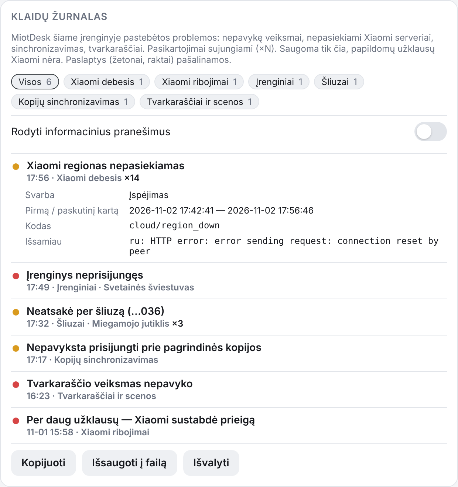 <em>40 pav. Blokas „Klaidų žurnalas“ (pirmas įrašas išskleistas)</em>

Kiekviename žurnalo įraše ([40 pav.](#fig-40-errlog)) yra:

- spalvotas svarbos taškas: 🔴 klaida, 🟠 įspėjimas, 🔵 informacija;
- problemos pavadinimas, paskutinio pasikartojimo laikas, grupė ir įrenginys (jei problema susijusi su įrenginiu);
- pasikartojimų skaičius **×N** — vienodos problemos nedubliuojamos, o sujungiamos į vieną įrašą.

**Darbas su žurnalu**

1. Atidarykite **Nustatymai** ir raskite bloką **Klaidų žurnalas**.
2. Norėdami rodyti tik vieną grupę, spustelėkite jos mygtuką virš sąrašo (šalia pavadinimo — įrašų skaičius). **Visi** panaikina filtrą.
3. Norėdami pamatyti išsamią informaciją, spustelėkite įrašą. *Atsiranda svarba, pirmas ir paskutinis pasikartojimas, komanda, kodas ir klaidos tekstas.*
4. Norėdami nusiųsti žurnalą palaikymui ar į forumą, spustelėkite **Kopijuoti** arba **Išsaugoti į failą** (failas `miotdesk-klaidos-MMMM-MM-DD.txt` aplanke „Atsisiuntimai“). Prie teksto pridedama programos versija ir sistema; įrenginių ID sutrumpinami.
5. Norėdami išvalyti žurnalą, spustelėkite **Išvalyti**, tada **Išvalyti viską?**.

Informaciniai pranešimai (pvz., „Neatsako vietiniu tinklu — naudojamas debesis“) pagal nutylėjimą paslėpti; norėdami juos matyti, įjunkite **Rodyti informacinius pranešimus**. Jie neįskaičiuojami į naujų klaidų skaičių.

> [!NOTE]
> Žetonai, sesijos raktai, slaptažodžiai ir užklausų adresų parametrai pašalinami iš teksto jau įrašant į žurnalą. Žurnale laikoma iki 300 įrašų; seniausi pašalinami automatiškai. Žurnalas neįtraukiamas į nustatymų atsarginę kopiją.

**Klaidų grupės**

| Grupė | Įrašų pavyzdžiai |
|---|---|
| Paskyra | Nepavyko prisijungti; Xiaomi reikalauja CAPTCHA; Xiaomi sesija baigėsi; nepavyko atnaujinti sesijos |
| Xiaomi debesis | Nėra ryšio su Xiaomi debesimi; Xiaomi regionas nepasiekiamas; Xiaomi serverio klaida; per ilga užklausa (414) |
| Xiaomi ribojimai | Per daug užklausų — Xiaomi sustabdė prieigą |
| Įrenginiai | Įrenginys neprisijungęs; įrenginys atmetė komandą |
| Šliuzai | Neatsako per šliuzą (…036); šliuzas atsako lėtai — apkrova sumažinta; šliuzas neprisijungęs / neatsako (su priežastimi ir apkrova prieš tai); šliuzas vėl veikia (neveikė nuo … iki …); šliuzas neatsako — jutikliai skaitomi iš debesies pranešimų |
| Vietinis tinklas | Neatsako vietiniu tinklu — naudojamas debesis; nepavyko paieška vietiniame tinkle; maršrutizatoriaus vietinės sąsajos klaida |
| Kopijų sinchronizavimas | Pagrindinė kopija senesnės versijos; skirtingos versijos; per mažai bendrų įrenginių; nepavyksta prisijungti; pagrindinė kopija nepasiekiama; bendri nustatymai — tik skaityti |
| Tvarkaraščiai ir scenos | Tvarkaraščio veiksmas nepavyko; tvarkaraštis praleistas (programa neveikė); scena nepasileido; automatizacija neperjungta |
| Duomenys ir grafikai | Neįkelta istorija, energijos statistika, siurblio žemėlapis ar įrenginio aprašas |
| Sistema | Pranešimai uždrausti sistemoje; failas neišsaugotas; tai ne MiotDesk atsarginės kopijos failas |
| Android | Android Keystore klaida |
| Programa | Sąsajos klaida; programos lūžis; vidinė klaida |

Jūsų pačių pradėtų veiksmų (mygtukai, slankikliai, scenos, prisijungimas) nesėkmės žymimos kaip **klaidos**; pasikartojančios fono atnaujinimo problemos — kaip **įspėjimai**. Jei ši kopija gauna duomenis per pagrindinę kopiją ([14 sk.](#sync)), pagrindinės kopijos debesies klaidos matomos ir jos žurnale.

### 13.6 Darbalaukio valdikliai

Pasirinktus įrenginius galima stebėti ir perjungti neatidarius MiotDesk lango:

- **Windows** — darbalaukio valdiklis programai 8GadgetPack;
- **macOS** — rodmenys meniu juostoje (šalia laikrodžio) ir darbalaukio valdiklis programai Übersicht;
- **Android** — telefono pradžios ekrano valdiklis.

Visose sistemose valdiklis veikia vienodai: tinklo servisas nenaudojamas, duomenys imami iš būsenų, kurias MiotDesk jau gavo, — papildomų užklausų Xiaomi nėra. Kiekvienam įrenginiui rodomas pavadinimas ir trumpa būsena (kaip kortelėje): jutiklio rodmenys, „Įjungta“ arba „Išjungta“, kelių klavišų jungiklio — klavišai su pavadinimais. Nustatymų blokas pavadintas pagal sistemą: **Windows darbalaukio valdiklis**, **macOS darbalaukio valdiklis** arba **Pradžios ekrano valdiklis**; Linux sistemoje jo nėra.

Bendri veiksmai visose sistemose:

1. Atidarykite **Nustatymai** ir įjunkite **Teikti duomenis valdikliui**.
2. Pažymėkite įrenginius, kuriuos norite matyti (padeda paieška). *Pasirinktų įrenginių skaičius rodomas virš sąrašo.*

#### Tvarka, vardai ir išvaizda

Pasirinkti įrenginiai išvardyti virš paieškos — tokia tvarka, kokia rodomi valdiklyje ([41 pav.](#fig-48-gadget-style)).

- Mygtukai ↑ ir ↓ perkelia įrenginį aukštyn ar žemyn, ✕ pašalina jį iš valdiklio.
- Vardo laukelyje galima įvesti trumpesnį vardą — jis naudojamas tik valdiklyje; vardas Mi Home ir MiotDesk nesikeičia. Tuščias laukelis — įprastas vardas.

Dalyje **Išvaizda** nustatoma:

- **Tema** — tamsi arba šviesi;
- **Fono nepermatomumas** — 100, 85, 70 arba 50 % (macOS ir Android; Windows valdiklio fonas visada vientisas — 8GadgetPack permatomą foną piešia su iškraipymais);
- **Akcento spalva** — įjungtų įrenginių taško ir klavišų spalva;
- **Kompaktiškai** — vardas ir reikšmė vienoje eilutėje;
- **Rodyti antraštę** — eilutė „MiotDesk“ viršuje;
- **Eilučių tarpai** — tankiai, įprastai arba laisvai.

Žemiau rodoma **peržiūra** — taip atrodys valdiklis (atsinaujina iš karto ir kas 5 sekundes). Pakeitimai valdiklyje matomi per 10 sekundžių (Android — kito atnaujinimo metu, ne vėliau kaip po minutės).

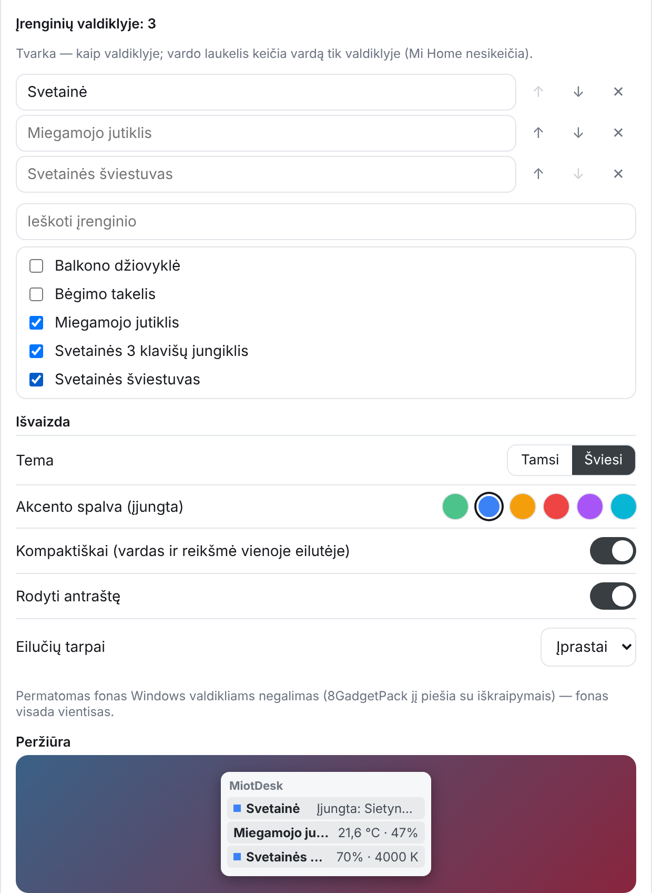 <em>41 pav. Tvarka, vardai, išvaizda ir peržiūra</em>

 <em>42 pav. Valdiklis su šviesia tema, kompaktiškai ir mėlynu akcentu</em>

#### Windows: 8GadgetPack valdiklis

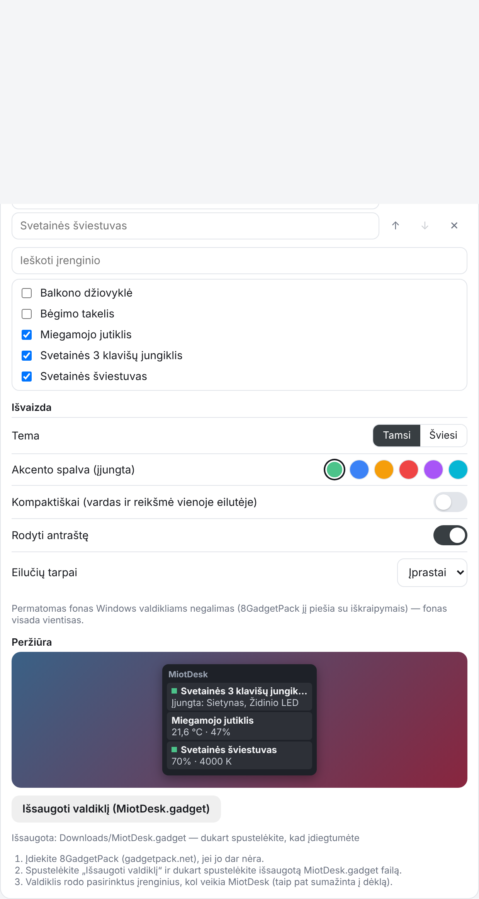 <em>43 pav. Blokas „Windows darbalaukio valdiklis“</em>

1. Įdiekite 8GadgetPack iš gadgetpack.net, jei jo dar nėra.
2. Bloke ([43 pav.](#fig-42-gadget-win)) spustelėkite **Išsaugoti valdiklį (MiotDesk.gadget)**. *Failas išsaugomas aplanke „Atsisiuntimai“.*
3. Dukart spustelėkite išsaugotą failą ir patvirtinkite diegimą. *Valdiklis atsiranda darbalaukyje ([44 pav.](#fig-45-gadget-desktop)).*

 <em>44 pav. MiotDesk valdiklis Windows darbalaukyje</em>

Valdiklis atsinaujina kas 10 sekundžių ir veikia, kol veikia MiotDesk (taip pat sumažinta į dėklą). Kai programa uždaryta, valdiklis rodo „MiotDesk neveikia“ arba „nėra naujų duomenų“.

#### macOS: meniu juosta ir Übersicht valdiklis

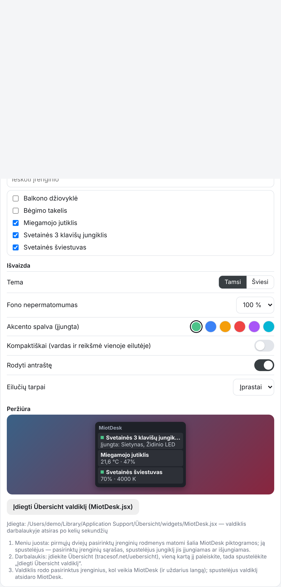 <em>45 pav. Blokas „macOS darbalaukio valdiklis“</em>

Bloke ([45 pav.](#fig-43-gadget-mac)) jungiklis **Rodyti meniu juostoje** įjungtas iš karto. Šalia MiotDesk piktogramos meniu juostoje rodomi pirmųjų dviejų pasirinktų įrenginių rodmenys ([46 pav.](#fig-46-gadget-macos), viršuje).

1. Spustelėkite MiotDesk piktogramą meniu juostoje. *Meniu pradžioje išvardyti pasirinkti įrenginiai su jų būsena.*
2. Spustelėkite jungiklį sąraše, kad jį įjungtumėte ar išjungtumėte: ● — įjungta, ○ — išjungta. *Kiekvienas kelių klavišų jungiklio klavišas — atskira eilutė su jo pavadinimu.*
3. Spustelėjus jutiklį ar kelių klavišų jungiklio pavadinimą atsidaro MiotDesk langas.

Darbalaukio valdiklis veikia nemokamoje programoje Übersicht (reikia macOS 12 ar naujesnės; Mac su Apple Silicon — M1, M2, M3 ir naujesniais — veikia be Rosetta). Įdiekite ją vienu iš būdų:

- **Iš svetainės:** atidarykite tracesof.net/uebersicht, spustelėkite **Download**, išskleiskite atsisiųstą `Uebersicht-….app.zip` ir perkelkite **Übersicht.app** į aplanką **Programos** (Applications).
- **Per Homebrew** (jei įdiegtas): terminale paleiskite `brew install --cask ubersicht`.

Pirmą kartą paleidžiant macOS gali neleisti atidaryti programos: **System Settings → Privacy & Security → Open Anyway**. Paleidus meniu juostoje atsiranda Übersicht piktograma; kad valdiklis būtų matomas ir paleidus kompiuterį iš naujo, piktogramos meniu įjunkite **Launch Übersicht when I login**. Programa atsinaujina pati.

1. Bent kartą paleiskite Übersicht — taip sukuriamas jo valdiklių aplankas.
2. Bloke spustelėkite **Įdiegti Übersicht valdiklį (MiotDesk.jsx)**. *Failas įrašomas tiesiai į Übersicht valdiklių aplanką, o po kelių sekundžių valdiklis atsiranda viršutiniame dešiniajame darbalaukio kampe.*
3. Jei Übersicht nerastas, failas išsaugomas aplanke „Atsisiuntimai“: Übersicht meniu pasirinkite **Open Widgets Folder** ir perkelkite failą ten.

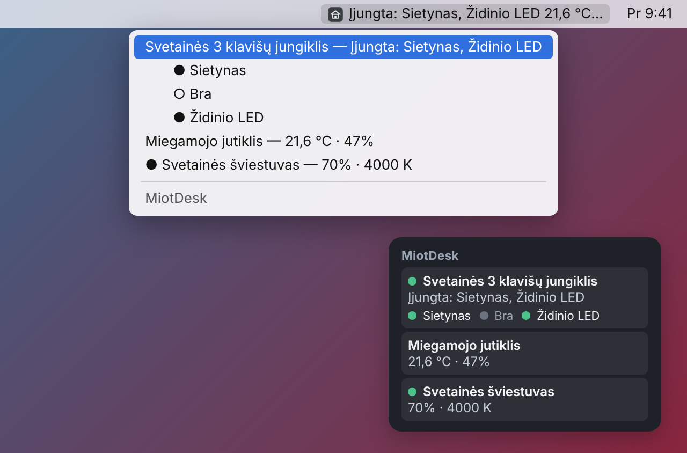 <em>46 pav. Meniu juosta ir Übersicht valdiklis macOS sistemoje (pavyzdys)</em>

Valdiklis atsinaujina kas 10 sekundžių; jį spustelėjus atsidaro MiotDesk. Kai programa uždaryta, valdiklis rodo „MiotDesk neveikia“ arba „nėra naujų duomenų“.

**Valdiklio vieta ir dydis.** Spalvos, permatomumas, tvarka ir vardai nustatomi MiotDesk programoje ([13.6 sk.](#set-gadget)). Vietą ekrane, plotį ir šrifto dydį galima pakeisti pačiame valdiklio faile:

1. Übersicht piktogramos meniu pasirinkite **Open Widgets Folder**.
2. Dešiniuoju pelės mygtuku spustelėkite `MiotDesk.jsx` → **Open With** → **TextEdit**.
3. Pakeiskite reikšmes failo pradžioje (žr. lentelę) ir išsaugokite (⌘+S). *Übersicht iš karto perpiešia valdiklį.*

| Eilutė faile | Ką keičia |
|---|---|
| `top: 40px;` | Atstumas nuo viršutinio ekrano krašto. Kad valdiklis būtų prie apatinio krašto, pakeiskite į `bottom: 40px;` |
| `right: 24px;` | Atstumas nuo dešiniojo krašto. Kairiajam kraštui — `left: 24px;` |
| `width: 230px;` | Valdiklio plotis |
| `font-size: 12px;` | Šrifto dydis |
| `border-radius: 12px;` | Kampų apvalinimas (0 — statūs kampai) |
| `refreshFrequency = 10000` | Kaip dažnai valdiklis perskaito duomenis, milisekundėmis (10000 = 10 s) |

> [!NOTE]
> Mygtukas „Įdiegti Übersicht valdiklį“ failą įrašo iš naujo ir panaikina jūsų pakeitimus — po jo pakartokite juos. Jei pakeitus valdiklis dingo, greičiausiai ištrintas kabliataškis ar kabutė: atkurkite pradinį failą tuo mygtuku.

#### Android: pradžios ekrano valdiklis

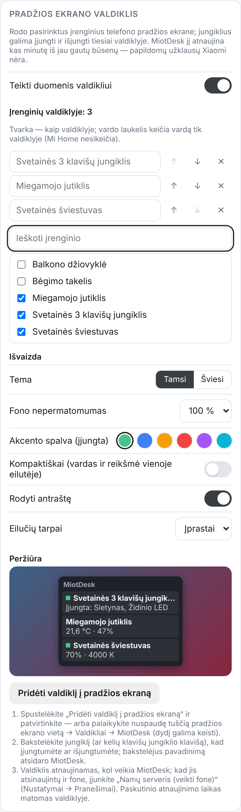 <em>47 pav. Blokas „Pradžios ekrano valdiklis“ telefone</em>

1. MiotDesk programoje įjunkite **Teikti duomenis valdikliui** ir pažymėkite įrenginius ([47 pav.](#fig-44-gadget-android)).
2. Spustelėkite **Pridėti valdiklį į pradžios ekraną** ir patvirtinkite atsidariusiame lange. *Arba rankiniu būdu: palaikykite nuspaudę tuščią pradžios ekrano vietą, pasirinkite **Valdikliai** → **MiotDesk** ir nutempkite valdiklį į ekraną. Valdiklio dydį galima keisti.*
3. Bakstelėkite jungiklį valdiklyje, kad jį įjungtumėte ar išjungtumėte. *Vienas jungiklis rodomas kaip perjungiklis, kelių klavišų jungiklis — apvaliais klavišų mygtukais su numeriu ir pavadinimu po kiekvienu.*
4. Bakstelėjus įrenginio pavadinimą ar antraštę atsidaro MiotDesk.

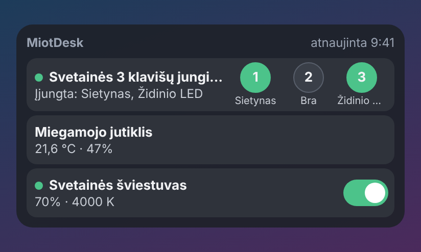 <em>48 pav. MiotDesk valdiklis pradžios ekrane (pavyzdys)</em>

MiotDesk atnaujina valdiklį kas minutę ir iš karto po bakstelėjimo valdiklyje; paskutinio atnaujinimo laikas matomas valdiklio antraštėje. Jei duomenų nėra ilgiau nei 3 minutes, valdiklis rodo „nėra naujų duomenų“. Kad valdiklis atsinaujintų ir tada, kai MiotDesk veikia fone, įjunkite **Namų serveris (veikti fone)** bloke **Pranešimai** ([13.3 sk.](#set-notify)). Kai programa uždaryta, bakstelėjus jungiklį atsidaro MiotDesk, o jungiklis perjungiamas įkėlus įrenginių sąrašą (jei nuo bakstelėjimo praėjo ne daugiau kaip 2 minutės).

> [!TIP]
> Xiaomi (MIUI / HyperOS): jei spustelėjus mygtuką langas neatsidarė, atidarykite **Nustatymai → Programos → MiotDesk → Kiti leidimai**, leiskite **Pradžios ekrano nuorodos** ir spustelėkite mygtuką dar kartą. Rankiniu būdu: palaikykite tuščią ekrano vietą → **Valdikliai** → sąraše raskite **MiotDesk**.

> [!IMPORTANT]
> Pradžios ekrano valdiklis yra Android versijoje 0.16.0 ir naujesnėse: atnaujinę programą, įdiekite naują 0.16.0 APK ([5 sk.](#install)). Senesnėje versijoje šio bloko nustatymuose nėra.

### 13.7 Žymos

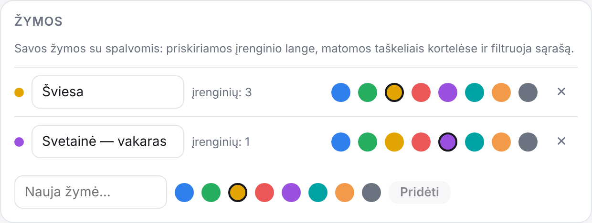 <em>49 pav. Blokas „Žymos“ nustatymuose</em>

Šis blokas ([49 pav.](#fig-35-set-tags)) veikia kaip žymų tvarkymas ([10.4 sk.](#tag-edit) ir [10.5 sk.](#tag-delete)): pervadinimas, spalvos keitimas, ištrynimas su ✕ ir patvirtinimu, naujos žymos sukūrimas.

### 13.8 Atsarginė kopija

 <em>50 pav. Blokas „Atsarginė kopija“</em>

**Išsaugoti į failą** įrašo visus MiotDesk nustatymus (mėgstamiausius, grupes, žymas, pavadinimus, piktogramas, pranešimus, kainą, tvarkaraščius, galios vertes, dalių įrašus) ir žurnalus į vieną JSON failą aplanke „Atsisiuntimai“. Xiaomi slaptažodis ir sesija neįtraukiami.

1. Norėdami atkurti, spustelėkite **Atkurti iš failo…** ir pasirinkite failą.
2. Patikrinkite įrašų skaičių bei datą ir spustelėkite **Atkurti ir paleisti iš naujo**. *Dabartiniai nustatymai pakeičiami nustatymais iš failo.*

## 14. Kelios MiotDesk kopijos

<a href="README.md#sync">In English</a>

### 14.1 Kaip veikia sinchronizavimas

Jei MiotDesk su ta pačia paskyra veikia keliuose įrenginiuose (kompiuteriuose, telefone) viename vietiniame tinkle, kopijos viena kitą randa automatiškai. Viena iš jų tampa **pagrindine kopija** ir kalbasi su Xiaomi; kitos gauna duomenis per ją vietiniu tinklu, šifruotai. Apkrova Xiaomi paskyrai nedidėja. Kopijų nustatyti ar susieti nereikia.

Android kopija tampa pagrindine, jei ji atidaryta ekrane arba įjungtas režimas **Namų serveris**; kitaip — pirmoji paleista kopija. Antrinė kopija rodo „Duomenys gaunami per MiotDesk įrenginyje „…“ vietiniu tinklu“ ir mygtuką **Perimti**, kuris dabartinę kopiją padaro pagrindine.

Šliuzo jutiklius pagrindinė kopija atnaujina ir fone (taip pat Android su išjungtu ekranu), kol ja naudojasi kitos kopijos. Jei iš pagrindinės kopijos 3 minutes negaunama naujų šliuzo duomenų, kopija skaito jutiklius pati, kol pagrindinė vėl ima veikti.

### 14.2 Bendri nustatymai

Tarp kopijų sinchronizuojamos piktogramos, žymos, mėgstamiausi, grupės, tvarka, paslėpti įrenginiai, tvarkaraščiai, laikmačiai, galios vertės, ribos ir kaina. Kalba, išdėstymas, kortelių dydžiai, pranešimai ir atnaujinimo intervalas — atskiri kiekvienai kopijai.

> [!IMPORTANT]
> Jei paskyra turi Android kopiją, ji yra pagrindinis bendrų nustatymų šaltinis. Kompiuteris gali juos keisti tik prisijungęs prie Android kopijos; kitaip bendri nustatymai tik skaitomi („Bendri nustatymai — tik skaityti“). Norėdami leisti keisti be telefono, užklausų statistikoje (Nustatymai → Ryšys) spustelėkite **Leisti keisti be Android**.

### 14.3 Namų serveris Android telefone

Telefono nustatymas **Namų serveris (veikti fone)** išlaiko telefoną pagrindine kopija net išjungus ekraną: to paties Wi-Fi kompiuteriai gauna duomenis per jį. Rodomas nuolatinis pranešimas, sunaudojama daugiau baterijos.

### 14.4 Sinchronizavimo būsena

Bloko „Ryšys“ eilutė **Kopijų sinchronizavimas** rodo: „per „…“ (šifruota, vietinis tinklas)“, „ši kopija aptarnauja kitas: N“, „kitų kopijų tinkle nėra“ arba priežastį, kodėl ryšio nėra (žr. [16 sk.](#trouble)). Ne namų tinkle šliuzo jutikliai atnaujinami kas 5 minutes — tai saugo šliuzą nuo pakibimo.

## 15. Duomenų saugojimas

<a href="README.md#data">In English</a>

| Duomenys | Kur saugoma |
|---|---|
| Xiaomi sesijos žetonai | Windows — Credential Manager; macOS — Keychain; Linux — Secret Service (keyutils); Android — programėlės šifruota saugykla (raktas Android Keystore) |
| Nustatymai, žymos, mėgstamiausi, paskutinė būsena, energijos talpykla | Programos įmontuotos naršyklės vietinė saugykla šiame įrenginyje (Windows — `%LOCALAPPDATA%\lt.igumenov.miotdesk`) |
| Klaidų žurnalas | Failas `errlog.json` programos duomenų aplanke (Windows — `%APPDATA%\lt.igumenov.miotdesk`) |
| Įrenginių modelių aprašai (specifikacijos) | Programos talpyklos aplankas |
| CSV failai, atsarginės kopijos ir išsaugoti klaidų žurnalai | Aplankas „Atsisiuntimai“; esami failai neperrašomi |

Visiškai pašalinus programą ([5.7 sk.](#uninstall)) ištrinama visa tai, išskyrus failus aplanke „Atsisiuntimai“.

## 16. Trikčių šalinimas

<a href="README.md#trouble">In English</a>

| Požymis | Galima priežastis | Ką daryti |
|---|---|---|
| Visi įrenginiai „neprisijungę“, įjungti rodomi išjungti | Iš debesies negauta būsena (tinklo sutrikimas, sustabdytos užklausos) | Palaukite kito atnaujinimo arba spauskite ⟳. Patikrinkite įrankių juostos laikmatį: „⏸“ reiškia Xiaomi paprašytą pauzę — palaukite iki nurodyto laiko |
| Pranešimas apie per dažnas užklausas | Viršytas leistinas užklausų dažnis | Nieko nedarykite: užklausos atsinaujins automatiškai ne anksčiau kaip po 15 minučių. Padidinkite atnaujinimo intervalą |
| Valymo metu robotas žemėlapyje stovi prie stotelės, valymo kelias neatnaujinamas | Xiaomi debesis saugo prieš valymą išsaugotą žemėlapį; robotas valymo metu nesiunčia duomenų arba modelis nepalaikomas | Palaukite 20 sekundžių arba spauskite ⟳. Jei nepadeda, valymo metu surinkite ataskaitą bloke **Siurblio derinimas** ([8.7 sk.](#dev-vacdebug)) ir nusiųskite ją kūrėjui |
| Statistikoje: „Regionas … nepasiekiamas“ | Šio regiono Xiaomi serveris nepasiekiamas iš jūsų tinklo (užblokuotas tiekėjo arba neveikia) | Nieko daryti nereikia: šio regiono įrenginiai rodo paskutinę būseną, kiti regionai atnaujinami įprastai, bandoma kas 5 minutes. Jei pranešimas išlieka ilgai, patikrinkite šiuos įrenginius Mi Home per tą patį ryšį |
| Įrenginys reaguoja lėtai | Valdymas per debesį, o ne vietiniu tinklu | Įjunkite **Pirmenybė vietiniam tinklui (LAN)**; macOS sistemoje leiskite prieigą prie vietinio tinklo; spustelėkite **Ieškoti įrenginių tinkle** |
| Nėra pranešimų | Pranešimai išjungti programoje arba sistemoje | Įjunkite **Sistemos pranešimai** ir spustelėkite **Išbandyti pranešimą**; patikrinkite OS pranešimų nustatymus |
| Sinchronizavimas: „pagrindinė kopija senesnės versijos“ / „skirtingos MiotDesk versijos“ | Skirtingų versijų kopijos | Atnaujinkite visas kopijas iki tos pačios versijos |
| Sinchronizavimas: „nepavyksta prisijungti“ | Ugniasienė arba Wi-Fi klientų izoliacija | Leiskite MiotDesk ugniasienėje (UDP 54329 ir TCP 54330 vietiniame tinkle) ir maršrutizatoriuje išjunkite klientų izoliaciją |
| Sinchronizavimas: „per mažai bendrų įrenginių“ | Kopijos prisijungusios prie skirtingų paskyrų | Visose kopijose prisijunkite ta pačia paskyra |
| Kompiuteris: „Bendri nustatymai — tik skaityti“ | Android kopija nepasiekiama | Atidarykite MiotDesk telefone arba spustelėkite **Leisti keisti be Android** |
| Android: atnaujinimas neįsidiegia ant senos versijos | APK nesuderinamas su įdiegta versija | Išsaugokite nustatymų atsarginę kopiją ([13.8 sk.](#set-backup)), pašalinkite seną versiją, įdiekite naują ir atkurkite nustatymus |
| Nėra energijos statistikos | Xiaomi nepateikia statistikos už laikotarpį | Patikrinkite statistiką Mi Home; įrenginiams be matuoklio įveskite galią ([11.3 sk.](#est)) |
| Nėra piktogramos dėkle (Linux) | Neįdiegta indikatorių biblioteka | Įdiekite paketą `libayatana-appindicator3-1` |

Dauguma šių problemų įrašoma į klaidų žurnalą ([13.5 sk.](#set-errlog)). Prašydami pagalbos, žurnale spustelėkite **Kopijuoti** arba **Išsaugoti į failą** ir pridėkite tekstą — jame jau yra programos versija ir sistema, o paslaptys pašalintos.

## 17. Žodynėlis

<a href="README.md#glossary">In English</a>

| Terminas | Apibrėžtis |
|---|---|
| Mi Home | Oficiali Xiaomi išmaniųjų namų programėlė |
| MIoT | Xiaomi įrenginių aprašymo standartas; pagal jį MiotDesk sudaro valdymo langą |
| Serverio regionas | Xiaomi debesies serveris (Europa, Kinija, JAV, Rusija, Singapūras, Indija), kuriame užregistruotas įrenginys |
| Vietinis tinklas (LAN) | Namų tinklas, prie kurio prijungti kompiuteris ir Wi-Fi įrenginiai |
| Šliuzas | Įrenginys, per kurį prie tinklo jungiami Zigbee ir BLE jutikliai (pvz., Mi Smart Home Hub) |
| Kortelė (plytelė) | Įrenginio stačiakampis sąraše |
| Žyma | Naudotojo sukurta spalvota etiketė įrenginiams grupuoti ir filtruoti |
| Grupė | Įrenginių rinkinys, įjungiamas ir išjungiamas vienu mygtuku |
| Scena | Rankiniu būdu paleidžiamas Mi Home veiksmų rinkinys |
| Automatizacija | Mi Home taisyklė „jei … tai …“, vykdoma debesies arba šliuzo |
| Tvarkaraštis | MiotDesk veiksmas nustatytu laiku, vykdomas pačios programos |
| Apytikslis suvartojimas | Elektros sąnaudos, apskaičiuotos pagal įvestą galią ir veikimo laiką |
| Pagrindinė kopija | MiotDesk kopija, kuri visų tinklo kopijų vardu kalbasi su Xiaomi |
| Sesijos žetonas | Xiaomi po prisijungimo išduodamas prieigos raktas; jis pakeičia slaptažodžio saugojimą |
| Klaidų žurnalas | Programos pastebėtų problemų sąrašas, sugrupuotas pagal tipą |
| CSV | Tekstinis lentelės formatas, atidaromas Excel ir kitomis programomis |

## Rodyklė

**A**  
[Android valdiklis](#set-gadget) · 13.6  
[Atnaujinimas](#update) · 5.6  
[Atnaujinimo intervalas](#set-conn) · 13.4  
[Atsarginė kopija](#set-backup) · 13.8  
[Atsijungimas](#logout) · 6.4  
[Automatizacijos](#scenes) · 12.3  

**C**  
[CSV](#dev-chart) · 8.5  

**D**  
[Darbalaukio valdikliai](#set-gadget) · 13.6  
[Dėklas](#tray) · 7.4  
[Duomenų saugojimas](#data) · 15  
[Dviejų žingsnių patvirtinimas](#login-2fa) · 6.2  

**E**  
[Eksploatacinės medžiagos](#consumables) · 12.2  
[Elektros kaina](#energy-page) · 11.2  
[Energija, skyrius](#energy-page) · 11.2  

**G**  
[Galia, įvedimas](#est) · 11.3  
[Grupės](#groups) · 9.2  

**Į**  
[Įdiegimas](#install) · 5  
[Įrenginio paslėpimas](#dev-head) · 8.1  
[Įrenginio piktograma](#dev-head) · 8.1  

**K**  
[Kelių klavišų jungiklis — klavišų pavadinimai](#card) · 7.2  
[Kiosko režimas](#inst-linux) · 5.2  
[Klaidų grupės](#set-errlog) · 13.5  
[Klaidų žurnalas](#set-errlog) · 13.5  
[Kopijų sinchronizavimas](#sync) · 14  
[Kortelė](#card) · 7.2  
[Kortelių tvarka](#order) · 9.3  

**L**  
[Laikmatis](#dev-timer) · 8.3  

**M**  
[Meniu juosta (macOS)](#set-gadget) · 13.6  
[Mėgstamiausi](#fav-add) · 9.1  

**N**  
[Namų serveris](#sync-android) · 14.3  
[Namų suvestinė](#overview) · 12.4  

**P**  
[Pagrindinė kopija](#sync-how) · 14.1  
[Paskyros apsauga](#account-safety) · 2.2  
[Pašalinimas](#uninstall) · 5.7  
[Patvirtinimo kodas](#login-2fa) · 6.2  
[Pranešimai](#set-notify) · 13.3  
[Pranešimų ribos](#dev-sensor) · 8.4  
[Prisijungimas](#login-proc) · 6.1  
[Privatumas](#privacy) · 2.3  

**R**  
[Raspberry Pi](#inst-rpi) · 5.3  
[Raspberry Pi — sieninis skydelis](#inst-rpi) · 5.3  
[Ryšys](#connectivity) · 12.5  

**S**  
[Scenos](#scenes) · 12.3  
[Serverio regionas](#login-proc) · 6.1  
[Siurblys robotas](#dev-vacuum) · 8.6  
[Siurblys robotas — derinimas](#dev-vacdebug) · 8.7  
[Suvartojimas, apytikslis](#est) · 11.3  
[Suvartojimas, išmatuotas](#energy-plug) · 11.1  

**T**  
[Trikčių šalinimas](#trouble) · 16  
[Tvarkaraščiai](#schedules) · 12.1  

**V**  
[Valdiklio išvaizda, tvarka ir vardai](#set-gadget) · 13.6  

**Ž**  
[Žymos — filtras](#tag-filter) · 10.3  
[Žymos — ištrynimas](#tag-delete) · 10.5  
[Žymos — pervadinimas](#tag-edit) · 10.4  
[Žymos — priskyrimas](#tag-assign) · 10.2  
[Žymos — sukūrimas](#tag-create) · 10.1  

**W**  
[Windows valdiklis](#set-gadget) · 13.6  

**Ü**  
[Übersicht](#set-gadget) · 13.6  
[Übersicht — įdiegimas](#set-gadget) · 13.6  
[Übersicht — valdiklio vieta ir dydis](#set-gadget) · 13.6  

---

<b>Lietuvių</b> · <a href="README.md">English</a>

MiotDesk 0.16.0 · Naudotojo vadovas, 2.2 leidimas · © 2026 Aleksandr Igumenov · MIT licencija.
„Xiaomi“, „Mi Home“ ir „Xiaomi Home“ yra Xiaomi Inc. prekių ženklai. Ekrano nuotraukos padarytos programos demonstraciniu režimu; įrenginių pavadinimai ir rodmenys išgalvoti.
