
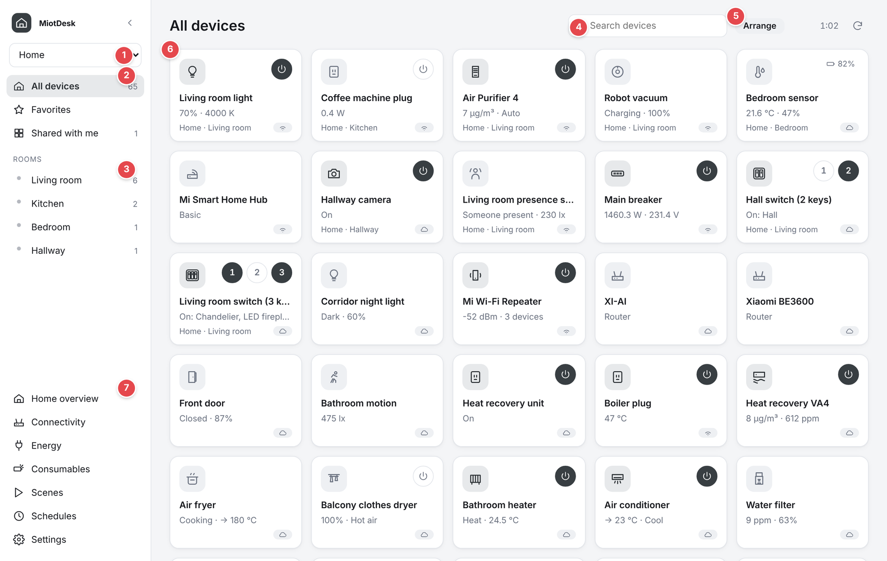

<h1 align="center">MiotDesk — User Manual</h1>

Unofficial Xiaomi Mi Home client for Windows, macOS, Linux and Android 
Software version <b>0.12.0</b> · Manual edition <b>1.2</b> · 2026-10-27 · English

> [!CAUTION]
> MiotDesk is **not affiliated with Xiaomi**. Read [section 2](#safety) “Safety and limitations” before you start.

| Document | |
|---|---|
| Title | MiotDesk. User Manual |
| Product | MiotDesk 0.12.0 for Windows 10/11, macOS, Linux (Debian / Ubuntu / Mint) and Android |
| Edition / date | 1.2 / 2026-10-27 |
| Author | Aleksandr Igumenov |
| Audience | Mi Home users without special technical training |
| Structure | Prepared following ISO/IEC/IEEE 26514 (information for users of software) and IEC/IEEE 82079-1 (preparation of information for use) |
| License | MIT — see [LICENSE](LICENSE) |

**Revision history**

| Edition | Date | Software | Changes |
|---|---|---|---|
| 1.1 | 2026-10-27 | 0.11.10 | Unreachable Xiaomi region |
| 1.2 | 2026-10-27 | 0.12.0 | Error log; first English edition |

## Contents

- [1. About this manual](#about)
   - [1.1 Purpose](#purpose)
   - [1.2 Who it is for](#audience)
   - [1.3 How to use this manual](#howto)
   - [1.4 Conventions](#conventions)
   - [1.5 Related documents](#related)
- [2. Safety and limitations](#safety)
   - [2.1 Status of the program](#status)
   - [2.2 Protecting your Xiaomi account](#account-safety)
   - [2.3 Privacy](#privacy)
   - [2.4 Limitations](#limits)
- [3. Product description](#product)
   - [3.1 Main features](#features)
   - [3.2 How it works](#principle)
- [4. System requirements](#requirements)
- [5. Installation, update and removal](#install)
   - [5.1 Windows](#inst-win)
   - [5.2 Linux (Debian, Ubuntu, Mint)](#inst-linux)
   - [5.3 macOS](#inst-mac)
   - [5.4 Android](#inst-android)
   - [5.5 Update](#update)
   - [5.6 Removal](#uninstall)
- [6. Signing in to the Xiaomi account](#login)
   - [6.1 Sign-in procedure](#login-proc)
   - [6.2 Sign-in confirmation (two-step verification)](#login-2fa)
   - [6.3 If you cannot sign in](#login-errors)
   - [6.4 Signing out](#logout)
- [7. Main window](#main)
   - [7.1 Overview of the main window](#main-overview)
   - [7.2 Device card](#card)
   - [7.3 Phone layout](#mobile)
   - [7.4 Running in the background](#tray)
- [8. Device window](#device)
   - [8.1 Device window header](#dev-head)
   - [8.2 Controlling a device](#dev-control)
   - [8.3 Quick timer](#dev-timer)
   - [8.4 Sensors and notification limits](#dev-sensor)
   - [8.5 History charts](#dev-chart)
   - [8.6 Robot vacuum](#dev-vacuum)
- [9. Favorites, groups and card order](#fav)
   - [9.1 Adding to favorites](#fav-add)
   - [9.2 Groups](#groups)
   - [9.3 Changing the card order](#order)
- [10. Tags](#tags)
   - [10.1 Creating a tag](#tag-create)
   - [10.2 Assigning and removing a tag](#tag-assign)
   - [10.3 Filtering by tag](#tag-filter)
   - [10.4 Renaming and recoloring](#tag-edit)
   - [10.5 Deleting a tag](#tag-delete)
- [11. Electricity consumption](#energy)
   - [11.1 Devices with a meter](#energy-plug)
   - [11.2 The “Energy” section](#energy-page)
   - [11.3 Adding a device without a meter](#est)
   - [11.4 How approximate consumption is shown](#est-result)
   - [11.5 Accuracy](#est-accuracy)
- [12. Other sections](#sections)
   - [12.1 Schedules and timers](#schedules)
   - [12.2 Consumables](#consumables)
   - [12.3 Scenes and automations](#scenes)
   - [12.4 Home overview](#overview)
   - [12.5 Connectivity](#connectivity)
- [13. Settings](#settings)
   - [13.1 Language, color and accessibility](#set-look)
   - [13.2 Layout](#set-layout)
   - [13.3 Notifications](#set-notify)
   - [13.4 Connection](#set-conn)
   - [13.5 Error log](#set-errlog)
   - [13.6 Tags](#set-tags)
   - [13.7 Backup](#set-backup)
- [14. Several copies of MiotDesk](#sync)
   - [14.1 How synchronization works](#sync-how)
   - [14.2 Shared settings](#sync-shared)
   - [14.3 Home server on Android](#sync-android)
   - [14.4 Synchronization state](#sync-status)
- [15. Data storage](#data)
- [16. Troubleshooting](#trouble)
- [17. Glossary](#glossary)
- [Index](#index)

## 1. About this manual

### 1.1 Purpose

This manual describes how to install, set up and use **MiotDesk 0.12.0** — an unofficial Xiaomi Mi Home smart-home client for computers and phones. It covers the whole user journey: from the first sign-in to the Xiaomi account to tracking electricity consumption and working with tags, including deleting them.

The manual applies to the stated version only. Some elements may look different in other versions.

### 1.2 Who it is for

The manual is written for owners of Xiaomi / Mi Home devices who:

- have already added their devices in the official Mi Home app on the phone;
- know how to install programs on their operating system;
- do not need technical knowledge — special terms are explained in the text and in the [glossary](#glossary).

### 1.3 How to use this manual

Sections follow the order in which the program is usually learned. For a quick start, read [section 2](#safety), [section 5](#install) and [section 6](#login). The other sections can be read selectively using the contents or the index at the end.

Procedures are written as numbered steps. Perform the steps in order; where the result matters it is given in *italics* after the step.

### 1.4 Conventions

| Notation | Meaning |
|---|---|
| **Sign in** | Interface element: button, field, menu item, switch — written exactly as shown in the program |
| **Settings → Layout** | Path: open the listed items one after another |
| “Living room light” | Example name of a device, room or tag. Yours will differ |
| `%LOCALAPPDATA%` | File or folder name, command or value typed literally |
| ① ② ③ | Callout number on a figure, explained in the table below the figure |
| *Italic text after a step* | Expected result of the step |

Safety notes and important remarks are marked like this (by importance):

> [!WARNING]
> Risk of data loss, account blocking or device malfunction. Always follow the instruction.

> [!IMPORTANT]
> Information without which a function may work incorrectly.

> [!NOTE]
> Additional explanation.

> [!TIP]
> A technique that makes work easier.

### 1.5 Related documents

- The official Mi Home (Xiaomi Home) app — adding and pairing devices, creating automations.
- Manuals of your devices — power values for estimating consumption ([section 11.3](#est)).
- Release notes — in the program thread on the forum where the release is published.

## 2. Safety and limitations

### 2.1 Status of the program

MiotDesk is unofficial software. It is not affiliated with, endorsed by or supported by Xiaomi. “Xiaomi” and “Mi Home” are trademarks of Xiaomi Inc. MiotDesk talks to the same servers as the official app on behalf of your account.

### 2.2 Protecting your Xiaomi account

> [!WARNING]
> Too frequent requests to the Xiaomi cloud may lead to a temporary block of the account. Do not lower the refresh interval below the recommended 65 seconds without need ([section 13.4](#set-conn)), and do not run the program on many computers outside one local network.

The program has built-in protection:

- one combined request for the state of all devices per refresh interval (65 s by default) and a separate light refresh of sensors every 15 s;
- a rate limiter: background requests — at most 40 per minute, user actions — at most 60 per minute;
- when Xiaomi answers “too frequent”, all requests are paused automatically for at least 15 minutes and the resume time is shown;
- if several copies of MiotDesk with the same account run in one local network, only one of them talks to Xiaomi ([section 14](#sync)).

### 2.3 Privacy

- The password is sent only to `account.xiaomi.com` and is never stored.
- Only session tokens are kept on the device — in the system key store (Windows Credential Manager, macOS Keychain, Secret Service on Linux, the app's encrypted storage on Android).
- The program sends no data to third parties and uses no servers of its own. Copies of MiotDesk exchange data only inside the local network, encrypted.
- Coordinates for sunrise / sunset, the electricity price and all other settings are stored only on your device.

### 2.4 Limitations

- **Adding (pairing) new devices** is not possible in MiotDesk — use the official Mi Home app. Devices added there appear in MiotDesk automatically.
- Mi Home **automations** are created and edited only in Mi Home; MiotDesk can switch them on and off ([section 12.3](#scenes)).
- MiotDesk **schedules and timers** run only while the program is running (including minimized to the notification area).
- **Approximate consumption** of devices without a meter is calculated from the power you enter and is not a measurement ([section 11.5](#est-accuracy)).

## 3. Product description

### 3.1 Main features

- sign-in with a Xiaomi account (e-mail, phone or Xiaomi ID), confirmation by a code sent by e-mail or SMS;
- all devices from all Xiaomi server regions (Europe, China, USA, Russia, Singapore, India) in one list;
- control of any MIoT device: lights, plugs, switches, air purifiers and humidifiers, robot vacuums with maps, Zigbee / BLE sensors through a gateway, and more;
- local network control (faster and works without the internet) with automatic fallback to the cloud;
- sensor history charts, energy statistics, approximate consumption of devices without a meter;
- favorites, groups, your own colored tags, card order, hidden devices;
- schedules and timers, running scenes, switching automations;
- notifications (battery, consumables, water leak, smoke, open doors, temperature limits and more);
- an error log grouped by problem type;
- synchronization of several copies in the local network without third-party servers;
- user interface in English, Russian and Lithuanian.

### 3.2 How it works

MiotDesk gets the list of devices, homes and rooms from the Xiaomi cloud. The state of the devices is requested with one combined request per refresh interval. Wi-Fi devices in the same local network are read and controlled directly — faster and without the internet. If a device does not answer over the local network, the program uses the cloud automatically. Zigbee and Bluetooth (BLE) sensors always work through the gateway and the cloud.

At start-up the last saved state (not older than 7 days) is shown immediately and then refreshed. While the window is hidden, refreshing continues in the background.

## 4. System requirements

| Platform | Supported versions |
|---|---|
| Windows | Windows 10 or 11, 64-bit (x64) |
| Linux | Debian 12–13, Ubuntu 22.04 or later, Linux Mint 21 or later (x86-64) |
| macOS | macOS 10.15 or later, Apple Silicon or Intel |
| Android | Android 7.0 or later (tested on Android 12+) |

You also need:

- a Xiaomi account with devices added in Mi Home;
- internet access (for the Xiaomi cloud); for local control — a connection to the same network as the devices.

## 5. Installation, update and removal

### 5.1 Windows

**Installer**

1. Run `MiotDesk_0.12.0_x64-setup.exe`. Administrator rights are not required.
2. If Windows SmartScreen appears, click **More info**, then **Run anyway**.
3. Follow the installer. *A MiotDesk shortcut appears in the Start menu.*

**Portable version**

1. Unpack `MiotDesk_0.12.0_portable_x64.zip` to any folder.
2. Run `miotdesk.exe`. The files `miotdesk.exe` and `WebView2Loader.dll` must be in the same folder.

### 5.2 Linux (Debian, Ubuntu, Mint)

1. Right-click `MiotDesk_0.12.0_linux_amd64.run` and choose **Run as a program**.
2. Enter the administrator password. *The program is installed.*
3. Start MiotDesk from the menu: **Accessories (Utilities)** → **MiotDesk**.

The `MiotDesk_0.12.0_amd64.deb` package can also be installed with a double click.

### 5.3 macOS

1. Start MiotDesk from the **Applications** folder.
2. If macOS does not allow the program to open: **System Settings → Privacy & Security → Open Anyway**.
3. When macOS asks about local network access, click **Allow**. *Otherwise Wi-Fi devices are controlled only through the cloud.*
4. If macOS asks for Keychain access, choose **Always Allow**.

### 5.4 Android

1. Open `MiotDesk_0.12.0_android.apk` on the phone.
2. If Android asks, allow installing apps from this source.
3. Tap **Install**, then **Open**.

### 5.5 Update

Install the new version over the old one in the same way as the first installation. Settings and the sign-in are kept.

> [!IMPORTANT]
> If you use several copies of MiotDesk (computers and a phone), update all of them to the same version: copies of different versions do not synchronize ([section 14](#sync)).

### 5.6 Removal

- **Windows:** Settings → Apps → MiotDesk → Uninstall (for the portable version just delete its folder).
- **Linux:** run the `.run` file again and choose **Remove completely** (removes the program, settings, cache and the stored session).
- **macOS:** move MiotDesk from the Applications folder to the Trash.
- **Android:** uninstall the app in the usual way.

> [!TIP]
> Before removing the program or moving to another device, save a backup of the settings ([section 13.7](#set-backup)).

## 6. Signing in to the Xiaomi account

### 6.1 Sign-in procedure

On the first start the sign-in window opens ([Figure 1](#fig-02-login-filled)).

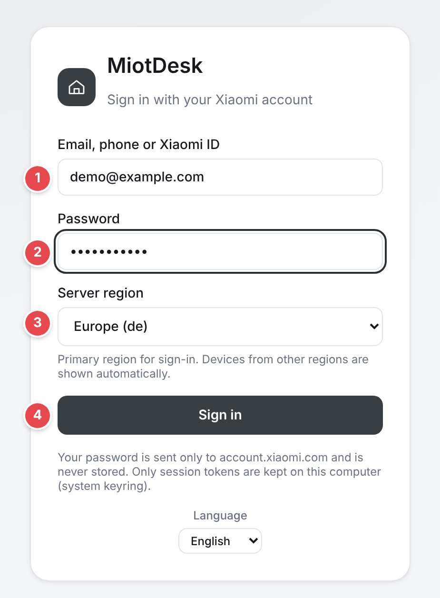 <em>Figure 1. Sign-in window with filled fields</em>

| No. | Element |
|---|---|
| 1 | **Email, phone or Xiaomi ID** — the Xiaomi account login, the same as in Mi Home |
| 2 | **Password** of the Xiaomi account |
| 3 | **Server region** — the main region chosen in Mi Home at registration. Devices from other regions are found automatically |
| 4 | **Sign in** button |

1. If needed, choose the interface language in the **Language** list at the bottom of the window.
2. Enter the login (1) and the password (2).
3. Choose the server region (3). If you do not know it, choose the region where you live; for Europe — **Europe (de)**.
4. Click **Sign in** (4). *If Xiaomi does not ask for confirmation, the main window opens ([section 7](#main)).*

> [!NOTE]
> On the first sign-in the program checks all Xiaomi regions and remembers where your devices are. Later it contacts only those regions. You do not need to sign in again after restarting the program.

### 6.2 Sign-in confirmation (two-step verification)

When you sign in from a new device, Xiaomi may ask for confirmation ([Figure 2](#fig-03-login-2fa)).

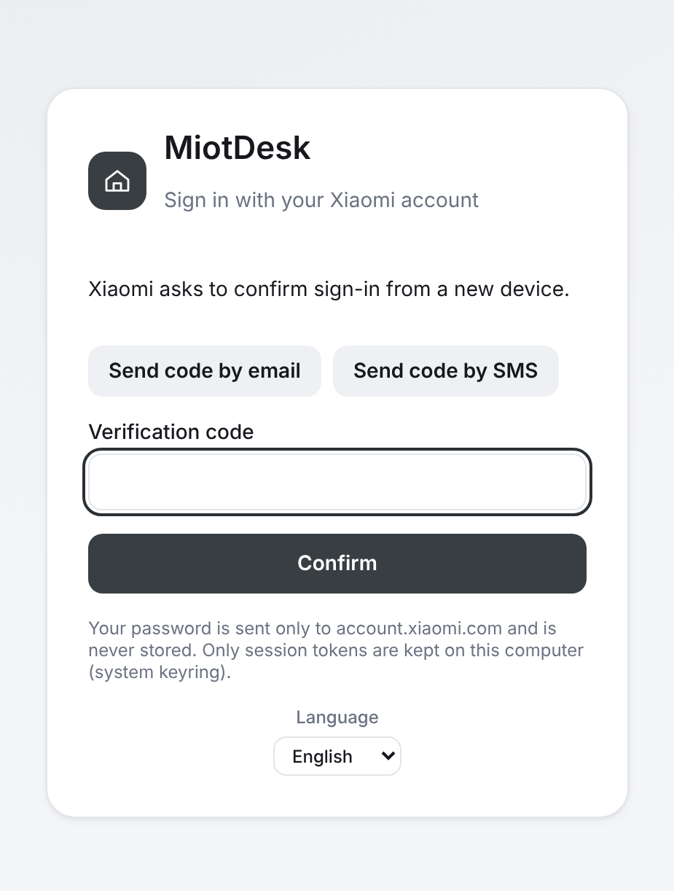 <em>Figure 2. Confirmation code request</em>

1. Click **Send code by email** or **Send code by SMS**. *The message “Code sent” appears.*
2. Type the received code into the **Verification code** field.
3. Click **Confirm**. *The main window opens.*

### 6.3 If you cannot sign in

| Message / symptom | What to do |
|---|---|
| Wrong login or password | Check the keyboard layout and the password by signing in at `account.xiaomi.com` in a browser |
| “Xiaomi temporarily requires CAPTCHA” | Sign in once at `account.xiaomi.com` in a browser, then repeat the sign-in in MiotDesk |
| Network error | Check the internet connection. Short failures are retried automatically (2 more attempts) |
| Empty device list | Check the server region; in **Settings → Connection** click **Search all regions again** |

### 6.4 Signing out

Open **Settings → Account** and click **Sign out**. Session tokens and the local copy of the state are removed from the device.

## 7. Main window

### 7.1 Overview of the main window

After sign-in the main window with the device list opens ([Figure 3](#fig-04-main)).

 <em>Figure 3. Main window, “All devices”</em>

| No. | Element |
|---|---|
| 1 | **Home selector.** If the account has several homes (including shared ones), choose a home or “All homes” here |
| 2 | **All devices**, **Favorites**, **Shared with me** (devices shared with you by other accounts). The number of devices is on the right |
| 3 | **Rooms** of the selected home with the number of devices in each |
| 4 | **Search devices** by name |
| 5 | **Arrange** — change the order of cards ([section 9.3](#order)). To the right — time until the next refresh and the refresh button ⟳ |
| 6 | **Device card** ([section 7.2](#card)) |
| 7 | Program sections: **Home overview**, **Connectivity**, **Energy**, **Consumables**, **Scenes**, **Schedules**, **Settings** |

The **‹** button at the top of the sidebar collapses it. The side panel mode (full, icons, hidden) is chosen in **Settings → Layout**.

The refresh timer shows the time until the next state request; during a refresh it shows “…”, while requests are paused — “⏸”. The ⟳ button can be pressed at most once every 15 seconds.

### 7.2 Device card

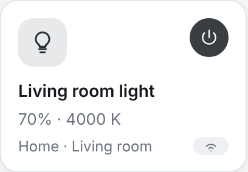 <em>Figure 4. Device card</em>

A card ([Figure 4](#fig-05-card)) shows:

- the device icon (top left) — automatic or chosen by you;
- the power button ⏻ (top right): dark — on, light — off. Multi-key switches show numbered key buttons instead;
- the name, a short state (for example “70% · 4000 K”) and the location “Home · Room”;
- the connection path icon bottom right: Wi-Fi — local network, cloud — through the Xiaomi cloud;
- colored dots above the power button — assigned tags ([section 10](#tags)); on sensors — the battery level.

An unreachable device is shown as a dimmed, inactive card. Clicking the card (anywhere except the power button) opens the device window.

### 7.3 Phone layout

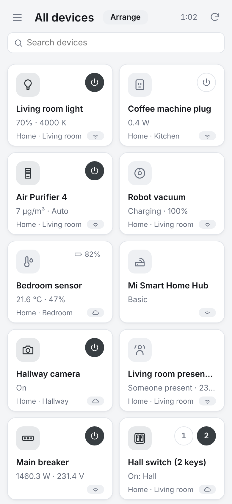 <em>Figure 5. Main screen on a phone</em>

On a phone ([Figure 5](#fig-39-mobile)) the sidebar opens with the ☰ button in the top left corner, and the device window takes the whole screen. All other elements and actions are the same as on a computer.

### 7.4 Running in the background

When you close the window on a computer, the program does not quit but hides to the notification area (tray); refreshing, notifications, schedules and timers keep working. The tray icon menu contains **Open MiotDesk**, **Favorites** (with switching), **Scenes** and **Quit**. On macOS the window comes back by clicking the Dock icon.

## 8. Device window

### 8.1 Device window header

Click a card — the device window opens on the right. Its header ([Figure 6](#fig-37-panel-head)) contains:

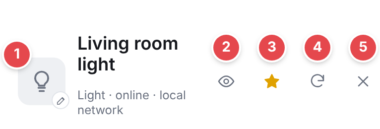 <em>Figure 6. Device window header</em>

| No. | Element |
|---|---|
| 1 | **Icon.** Click to choose an icon (about 50 options or your own picture) and the tile size: small, medium, large |
| 2 | **Hide from lists** (eye icon) — the device disappears from rooms and “All devices”. Notifications, favorites and groups keep working. The **Hidden: N** toolbar button shows hidden devices temporarily |
| 3 | **Add to favorites** ☆ ([section 9](#fav)) |
| 4 | **Refresh** the state of this device |
| 5 | **Close** the device window |

Below the name: device type, connection state (“online”) and path (“local network” or “cloud”).

### 8.2 Controlling a device

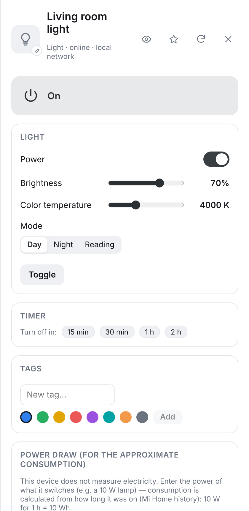 <em>Figure 7. Light window</em>

The device window is built automatically from the official description of the model (MIoT specification). Example for a light — [Figure 7](#fig-06-panel-light):

- the large button at the top (**On** / **Off**) switches the power;
- switches, sliders (brightness, color temperature) and button sets (mode) change the corresponding parameters;
- action buttons (for example **Toggle**) run a device command.

Changes are sent immediately. Values you have just set are protected from “bouncing back”: your value stays on screen until the device confirms it.

> [!NOTE]
> For an unreachable device the last known values are shown read-only with the time they last changed.

### 8.3 Quick timer

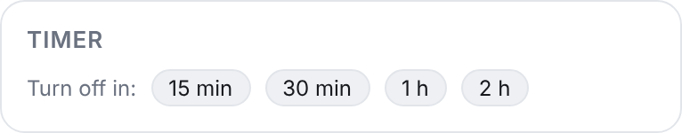 <em>Figure 8. The “Timer” block</em>

Devices with a power button have a **Timer** block ([Figure 8](#fig-07-panel-timer)): click **15 min**, **30 min**, **1 h** or **2 h**. A device that is on will be switched off, a device that is off — switched on after the chosen time. The time of execution is shown in the block and the timer can be cancelled. All timers are also listed under **Schedules** ([section 12.1](#schedules)).

### 8.4 Sensors and notification limits

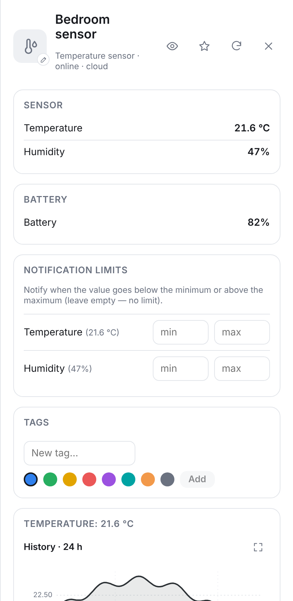 <em>Figure 9. Temperature and humidity sensor window</em>

A sensor window ([Figure 9](#fig-08-panel-sensor)) shows the current readings, the battery level and history charts. In the **Notification limits** block you can set **min** and / or **max** values for temperature, humidity, CO₂ and PM2.5. When a value crosses a limit you get a notification such as “Temperature 27.4 °C — above 26 °C”. It is repeated only after the value has returned to normal. An empty field means no limit.

### 8.5 History charts

The bottom of a sensor window shows a 24-hour chart. The enlarge button in its top right corner opens the chart in a separate window ([Figure 10](#fig-09-chart-window)).

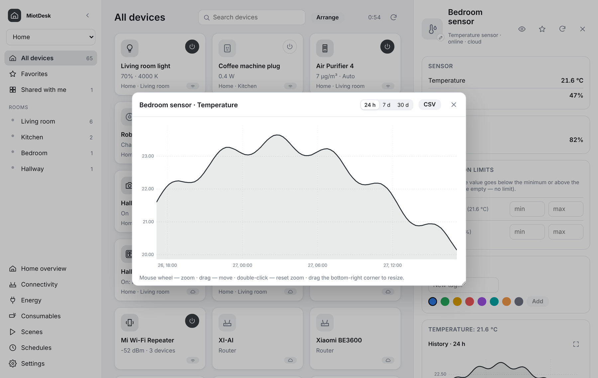 <em>Figure 10. History chart window</em>

- Period: **24 h**, **7 d**, **30 d**.
- Mouse wheel — zoom, drag — move, double click — reset zoom; resize the window by its bottom right corner.
- The value at a point is shown when you hover over it.
- **CSV** — save the data to a file for Excel (in the Downloads folder).
- Close the window with ✕ or the Esc key.

### 8.6 Robot vacuum

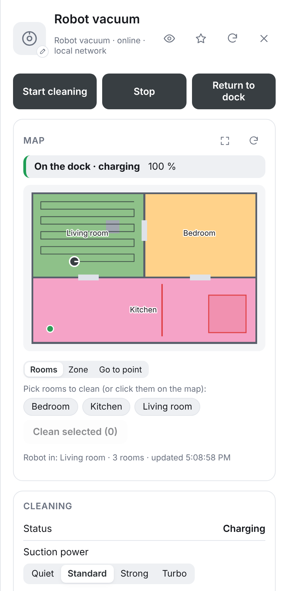 <em>Figure 11. Robot vacuum window</em>

For robot vacuums ([Figure 11](#fig-38-vacuum)) the top buttons are **Start cleaning**, **Stop**, **Return to dock**. The **Map** block shows the state (for example “On the dock · charging 100%”), the robot position and the rooms. Map modes:

- **Rooms** — choose rooms with the buttons below the map or by clicking the map, then click **Clean selected**;
- **Zone** — drag a rectangle on the map;
- **Go to point** — click the map, the robot drives there.

“Zone” and “Go to point” are available for Roborock and Dreame robots (including Xiaomi robots made by Dreame). Cleaning parameters (suction power and others) are below.

## 9. Favorites, groups and card order

### 9.1 Adding to favorites

1. Open the device window.
2. Click the star ☆ next to the name ([Figure 12](#fig-10-star)). *The star becomes filled; the device appears in Favorites and in the tray menu.*

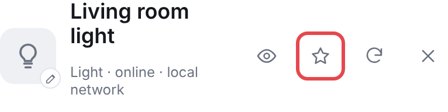 <em>Figure 12. “Add to favorites” button</em>

Clicking again removes the device from favorites.

### 9.2 Groups

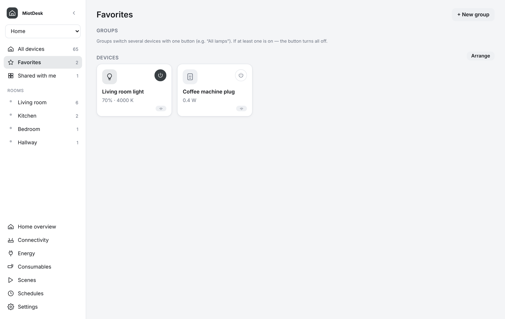 <em>Figure 13. Favorites</em>

A group switches several devices with one button (for example “All lamps”). If at least one device of the group is on, the button switches all of them off.

1. Open **Favorites** ([Figure 13](#fig-11-favorites)) and click **+ New group**.
2. Enter the **Group name** and tick the **Devices in the group**.
3. Click **Save**.

A group can be changed (**Edit**) or deleted (**Delete** → confirm). The group button shows how many devices are on, for example “On 2 of 3”.

### 9.3 Changing the card order

1. Open the list (a room, “All devices” or “Favorites”).
2. Click **Arrange** on the toolbar. *Arrows ◀ ▶ appear on the cards ([Figure 14](#fig-12-order)).*
3. Move the cards with the arrows or drag them with the mouse.
4. Click **Done**.

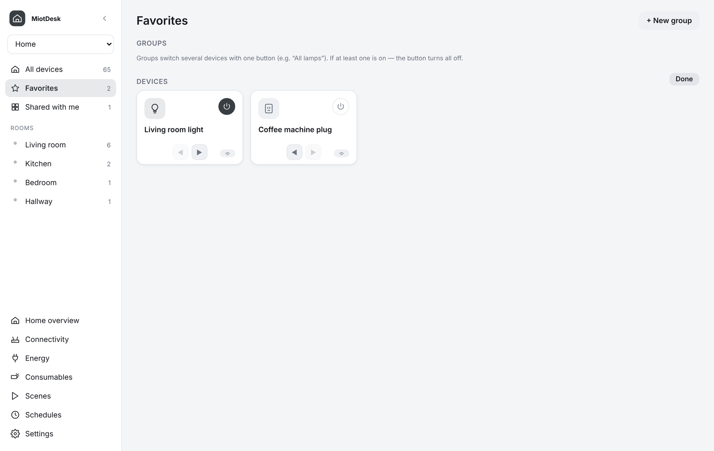 <em>Figure 14. Arrange mode</em>

The order is saved separately for each room; new devices are added at the end. The original order is restored with **Reset card order** in **Settings** (block “Card order and hidden devices”), which also lists hidden devices.

## 10. Tags

Tags are your own colored labels for devices (for example “Lights”, “Living room — evening”). A device can have several tags. Tags are shown as colored dots on the cards and let you filter the list.

### 10.1 Creating a tag

1. Open the window of any device and find the **Tags** block ([Figure 15](#fig-13-tags-empty)).
2. Type a name into **New tag…** (1).
3. Choose one of the eight colors (2) (the selected color is circled).
4. Click **Add**. *The tag is created and immediately assigned to this device ([Figure 17](#fig-15-tags-assigned)).*

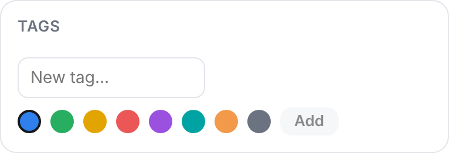 <em>Figure 15. The “Tags” block — no tags yet</em>

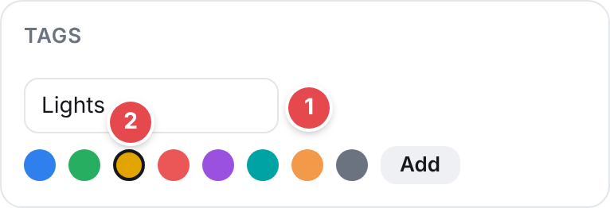 <em>Figure 16. Typing a name and choosing a color</em>

### 10.2 Assigning and removing a tag

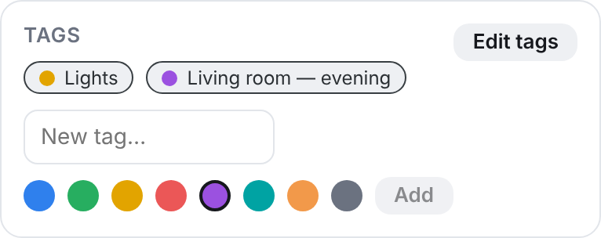 <em>Figure 17. Tags assigned to the device</em>

Existing tags are shown in the **Tags** block as buttons. An assigned tag has an outline.

1. Open the device window.
2. Click the tag button. *An unassigned tag is assigned, an assigned one is removed.*

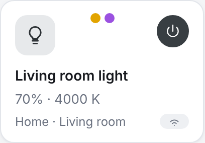 <em>Figure 18. Tag dots on a card</em>

Assigned tags appear on the device card as colored dots ([Figure 18](#fig-16-tag-dots)).

### 10.3 Filtering by tag

When at least one tag exists, a filter row appears above the device list ([Figure 19](#fig-17-tag-filter)).

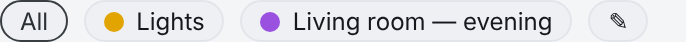 <em>Figure 19. Tag filter row</em>

1. Click a tag. *Only devices with this tag stay in the list ([Figure 20](#fig-18-tag-filtered)).*
2. To remove the filter, click **All** or click the selected tag again.

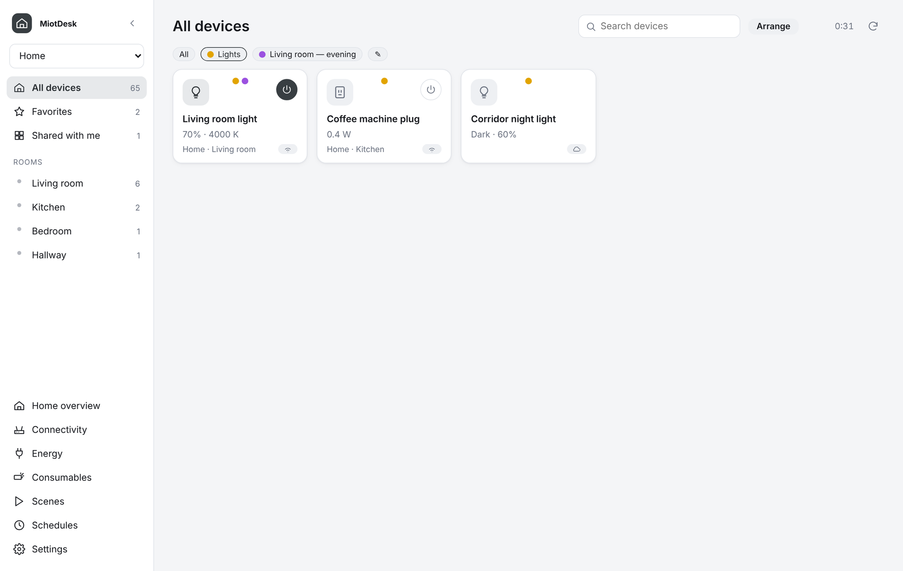 <em>Figure 20. List filtered by the “Lights” tag</em>

The ✎ button at the end of the filter row opens tag management ([section 10.4](#tag-edit)).

### 10.4 Renaming and recoloring

Tag management opens in any of three ways:

- the **Edit tags** button in the “Tags” block of a device window;
- the ✎ button in the filter row;
- **Settings → Tags** ([section 13.6](#set-tags)).

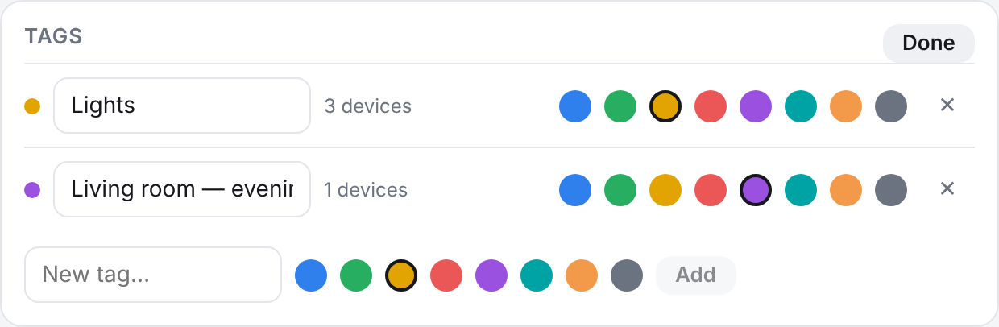 <em>Figure 21. Tag management</em>

The list ([Figure 21](#fig-19-tags-manage)) shows each tag's name, number of devices and color.

1. To rename a tag, edit the text in its name field.
2. To change the color, click another color circle in the tag's row.
3. Click **Done**. *Changes are visible on all cards and in the filter immediately.*

A new tag can also be created here — in the bottom row (**New tag…** → color → **Add**).

### 10.5 Deleting a tag

> [!IMPORTANT]
> A deleted tag is removed from all devices. Deletion cannot be undone — the tag would have to be created and assigned again.

1. Open tag management ([section 10.4](#tag-edit)).
2. Click ✕ in the tag's row. *A confirmation button with the number of devices appears instead of the cross, for example “Delete (removed from 1 devices)” ([Figure 22](#fig-19b-tags-delete)).*
3. Click the confirmation button. *The tag is deleted and removed from all devices.* If you changed your mind, do not click it and click **Done**.

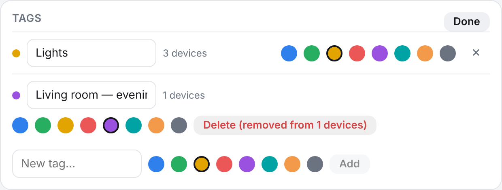 <em>Figure 22. Confirming tag deletion</em>

> [!NOTE]
> To remove a tag from one device only, do not delete it — click its button in the device window ([section 10.2](#tag-assign)).

## 11. Electricity consumption

MiotDesk shows electricity consumption in two ways:

- **measured** — for devices with a built-in meter (smart plugs, breakers, some switches), from Mi Home statistics;
- **approximate** — for devices without a meter (lamps, switches, humidifiers, robot vacuum dock): calculated from the power you enter and the operating time.

### 11.1 Devices with a meter

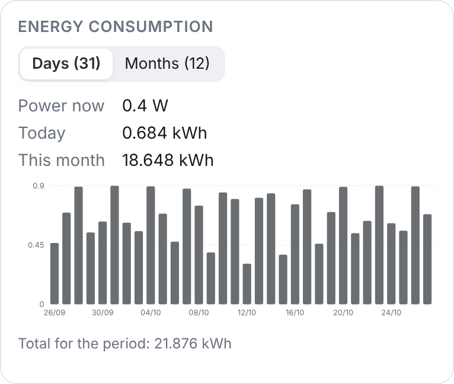 <em>Figure 23. The “Energy consumption” block of a plug</em>

The window of such a device has an **Energy consumption** block ([Figure 23](#fig-20-energy-plug)): **Power now**, consumption **Today** and **This month**, a chart by **Days (31)** or **Months (12)** and the **Total for the period**.

### 11.2 The “Energy” section

The **Energy** section in the sidebar ([Figure 24](#fig-21-energy-summary)) sums up all devices that report consumption to Mi Home:

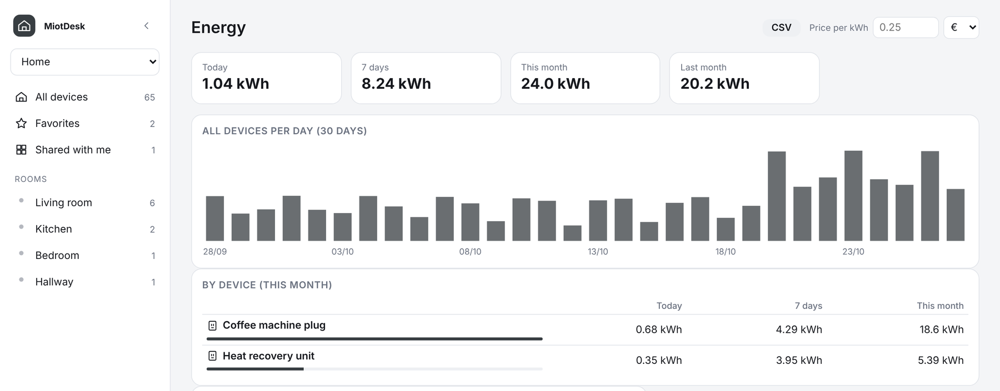 <em>Figure 24. The “Energy” section</em>

- tiles **Today**, **7 days**, **This month**, **Last month**;
- the chart **All devices per day (30 days)**;
- the table **By device (this month)** with the columns “Today”, “7 days”, “This month”;
- the **Price per kWh** field and currency — when filled in, the cost is shown next to the totals;
- the **CSV** button — save the data to a file.

> [!NOTE]
> Statistics are loaded only when the section is opened, one device at a time, and kept for 30 minutes. This avoids extra requests to Xiaomi. The price is stored only on this device.

### 11.3 Adding a device without a meter

For devices that do not measure electricity themselves you can enter the power of the connected load. Consumption is calculated as:

**Consumption (Wh) = Power (W) × Time switched on (h)**

For example, a 10 W lamp switched on for 1 hour uses 10 Wh. The operating time comes from the Mi Home state history.

1. Open the **Energy** section.
2. In the **Add a device without a meter** block open **Choose a device…** and select the device ([Figure 25](#fig-25-est-add)). *The device window opens.* You can also open the device window from the device list.
3. Find the **Power draw (for the approximate consumption)** block ([Figure 26](#fig-22-est-empty)).
4. In **Power when on** enter the power of what the device switches, in watts (from the lamp marking or the manual). For a multi-channel switch the power is entered for each channel.
5. Check the result. *Below the field a calculation appears, for example “Approximately: today 1.029 kWh, this month 1.029 kWh” ([Figure 27](#fig-23-est-filled)).*

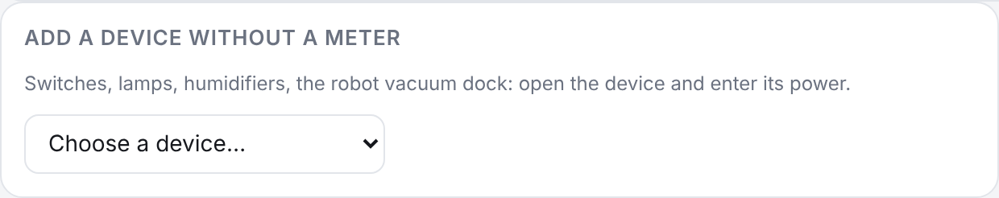 <em>Figure 25. The “Add a device without a meter” block</em>

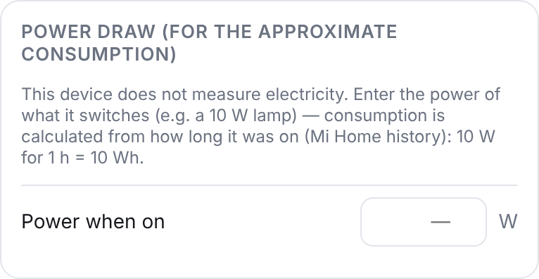 <em>Figure 26. Power not entered yet</em>

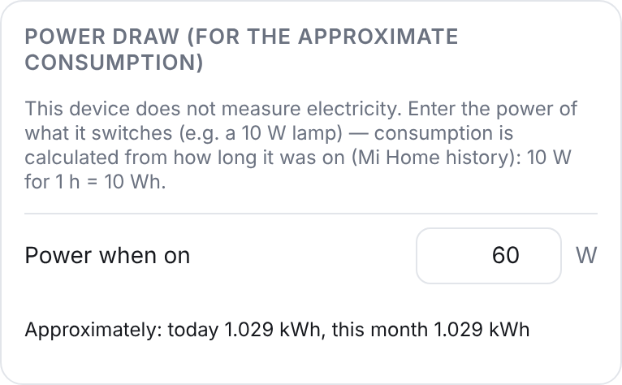 <em>Figure 27. Power entered — calculation shown</em>

To exclude a device from the calculation, clear the power field.

**Robot vacuum dock.** For a dock, three values from the manual are entered: **While charging**, **At rest** (robot charged or cleaning) and optionally **Dock washing / drying**. The time in each mode comes from the robot's state history.

### 11.4 How approximate consumption is shown

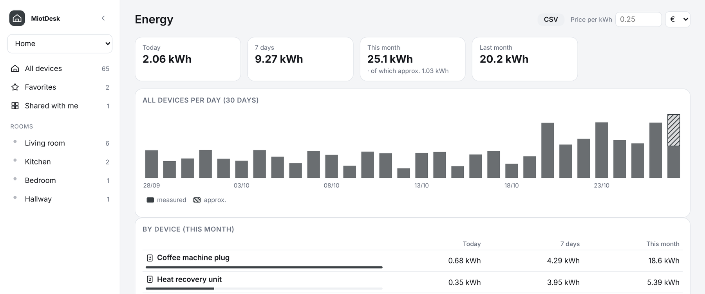 <em>Figure 28. “Energy” with a device without a meter</em>

After entering the power, the device is counted in **Energy** ([Figure 28](#fig-24-energy-summary-est)):

- in the table by device it is marked **≈ approx.**;
- the “This month” tile shows the approximate share: “of which approx. …”;
- in the chart the approximate part is a **hatched** top on the solid (measured) bar of the same width; the legend below the chart reads “measured” and “approx.”;
- approximate consumption is included in the totals and the cost.

### 11.5 Accuracy

> [!IMPORTANT]
> Approximate consumption is an estimate, not a measurement. Its accuracy depends on the power you entered and on the completeness of the Mi Home history. The program never substitutes a default power: the value is always entered by the user.

If today's state history is not yet available, today's consumption is calculated from midnight using the current state of the device.

## 12. Other sections

### 12.1 Schedules and timers

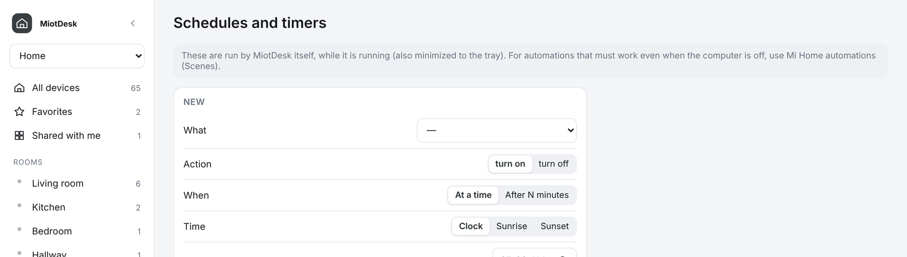 <em>Figure 29. “Schedules and timers”</em>

This section ([Figure 29](#fig-26-schedules)) switches devices and groups on and off or runs scenes on time.

1. In the **New** block choose a device, group or scene in **What**.
2. Choose the **Action**: **turn on** or **turn off**.
3. In **When** choose **At a time** or **After N minutes** (timer).
4. For a set time choose **Clock**, **Sunrise** or **Sunset** (with an offset from −240 to +240 minutes), set the time and the days of the week. Without selected days the schedule runs once.
5. Click **Add**.

> [!IMPORTANT]
> Schedules are run by MiotDesk itself while it is running. If the program was closed or the computer was asleep, an action is executed only if it is no more than 3 minutes late. For automations that must work while the computer is off, use Mi Home scenes.

For sunrise and sunset, enter the coordinates (latitude, longitude) once; they are stored only on the device. The log of recent executions is at the bottom of the section.

### 12.2 Consumables

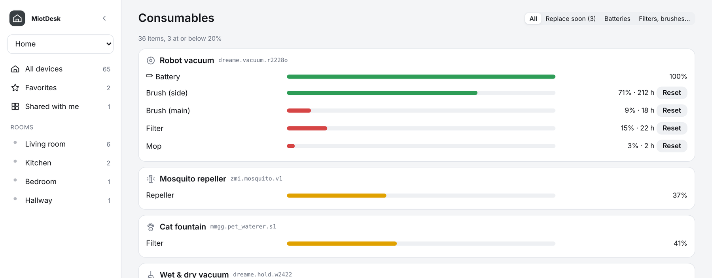 <em>Figure 30. “Consumables”</em>

This section ([Figure 30](#fig-27-consumables)) shows the remaining life of filters, brushes, mops and the battery level of all devices. Bar color: green — fine, yellow — replace soon, red — replace now. **Reset** resets the counter after a part has been replaced. Filters at the top right: **All**, **Replace**, **Batteries**, **Filters, brushes…**.

### 12.3 Scenes and automations

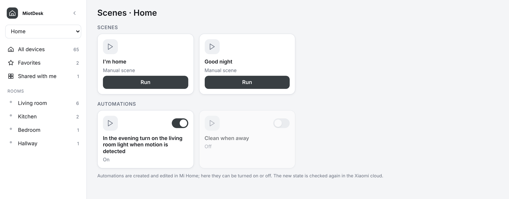 <em>Figure 31. “Scenes”</em>

In this section ([Figure 31](#fig-28-scenes)) manual Mi Home scenes are started with **Run**. Automations can be switched on and off; the new state is re-checked in the Xiaomi cloud. Automations are created and edited only in Mi Home.

### 12.4 Home overview

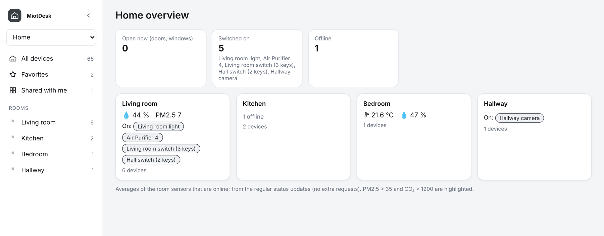 <em>Figure 32. “Home overview”</em>

This section ([Figure 32](#fig-29-overview)) shows a summary: open doors and windows, devices that are on, offline devices and average sensor readings per room. PM2.5 above 35 and CO₂ above 1200 are highlighted.

### 12.5 Connectivity

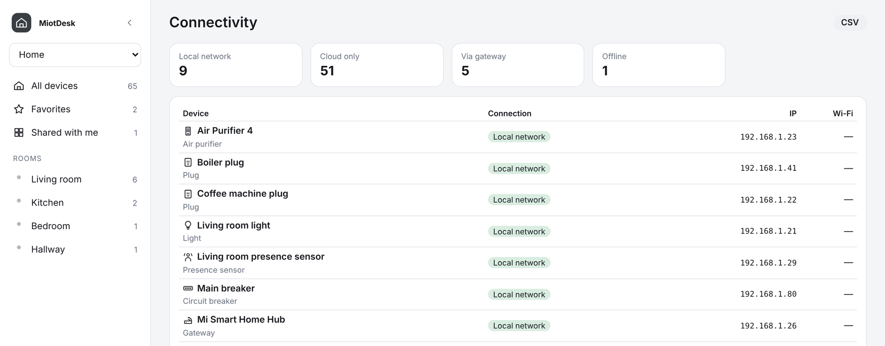 <em>Figure 33. “Connectivity”</em>

This section ([Figure 33](#fig-30-connectivity)) shows the connection path of each device: **Local network**, **Cloud only**, **Via gateway**, as well as the IP address, Wi-Fi signal and offline devices. The table can be sorted and saved with **CSV**.

## 13. Settings

The **Settings** section ([Figure 34](#fig-31-settings)) contains: Language, Accent color, Accessibility, Layout, Notifications, Connection, Error log, Tags, Card order and hidden devices, Backup, Account, About.

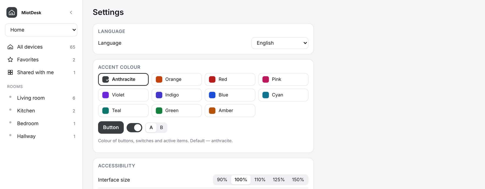 <em>Figure 34. “Settings”, top part</em>

### 13.1 Language, color and accessibility

- **Language** — English, Russian or Lithuanian.
- **Accent colour** — color of buttons, switches and active elements: anthracite (default) and 10 more colors. Light and dark themes follow the system setting.
- **Accessibility** — **Interface size** 90–150% (also Ctrl + / Ctrl − / Ctrl 0) and **High contrast**.

### 13.2 Layout

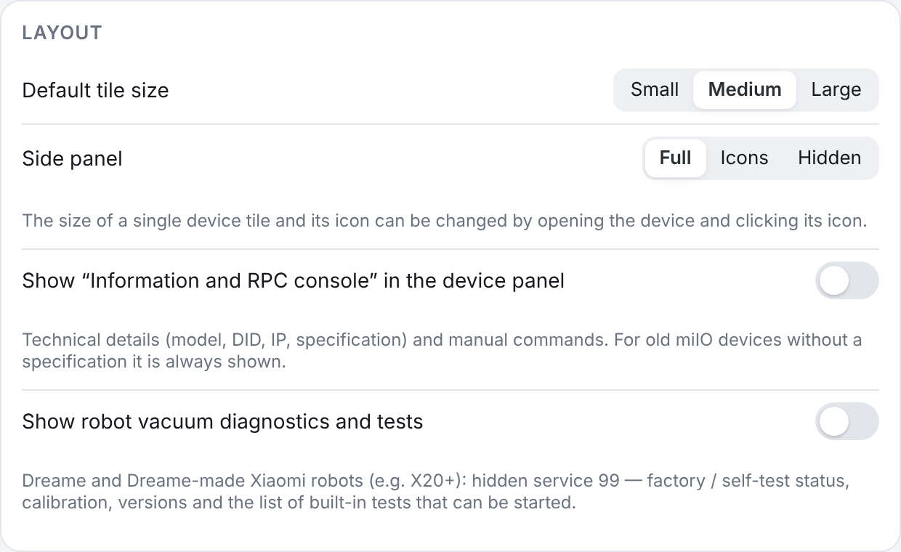 <em>Figure 35. The “Layout” block</em>

- **Default tile size**: Small, Medium, Large. The size of a single tile is changed in the device window by clicking its icon.
- **Side panel**: Full, Icons, Hidden.
- **Show “Information and RPC console” in the device panel** — technical data (model, DID, IP, specification) and manual commands. For advanced users.
- **Show robot vacuum diagnostics and tests** — service information of Dreame robots.

### 13.3 Notifications

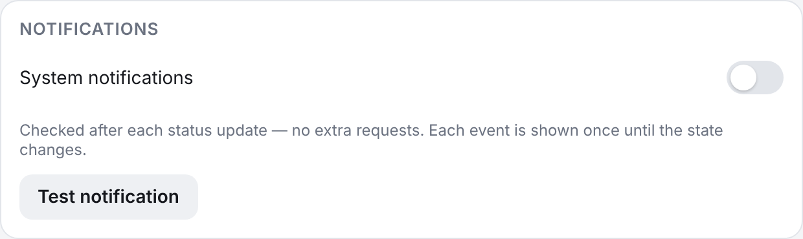 <em>Figure 36. The “Notifications” block</em>

Turn on **System notifications** and check them with **Test notification**. Notifications are evaluated after every state refresh, without extra requests; each event is shown once until the state changes. Notification types (battery, consumables, leak, smoke and gas, open doors, robot errors, device offline, internet down, temperature and air quality limits) are switched on individually.

### 13.4 Connection

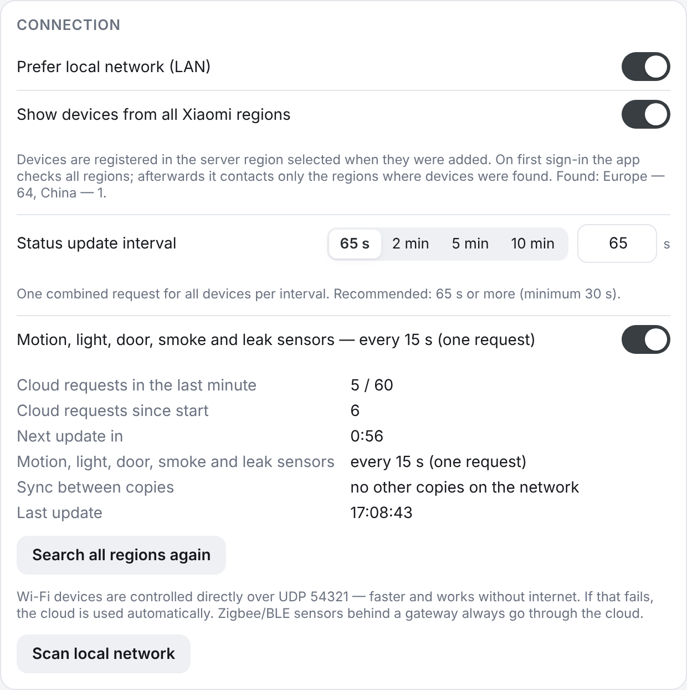 <em>Figure 37. The “Connection” block</em>

| Parameter | Description |
|---|---|
| **Prefer local network (LAN)** | Control Wi-Fi devices directly (UDP 54321). Recommended to keep on |
| **Show devices from all Xiaomi regions** | Combine devices of all regions. The number of devices found in each region is shown below |
| **Status update interval** | 65 s (recommended), 2, 5, 10 min or your own value, minimum 30 s |
| **Motion, light, door, smoke and leak sensors — every 15 s (one request)** | Fast refresh of these sensors with one request |
| Request statistics | Cloud requests per minute, since start, time to the next refresh, copy synchronization state ([section 14](#sync)), unreachable Xiaomi regions |
| **Search all regions again** | Search devices again, for example after a device moved to another region |
| **Scan local network** | Search Wi-Fi devices in the local network |

### 13.5 Error log

The **Error log** block collects problems noticed by the program on this device: failed actions, unreachable Xiaomi servers, copy synchronization failures, schedules that did not run, and so on. The log makes no extra requests to Xiaomi and is stored only on this device.

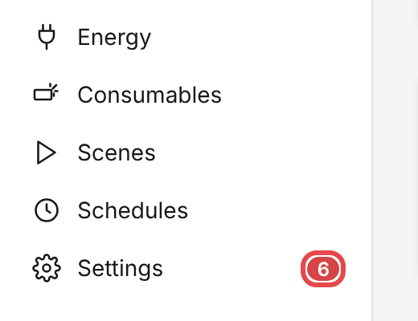 <em>Figure 38. Number of new errors next to “Settings”</em>

When new errors or warnings appear, their number is shown next to **Settings** in the sidebar ([Figure 38](#fig-41-errlog-badge)). It disappears after you open the log.

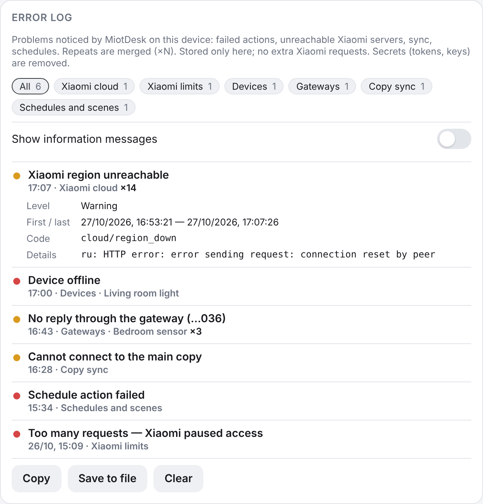 <em>Figure 39. The “Error log” block (first entry expanded)</em>

Each log entry ([Figure 39](#fig-40-errlog)) contains:

- a colored level dot: 🔴 error, 🟠 warning, 🔵 information;
- the problem name, the time it last occurred, the group and the device (if the problem concerns a device);
- the repeat count **×N** — identical problems are not duplicated but merged into one entry.

**Working with the log**

1. Open **Settings** and find the **Error log** block.
2. To show one group only, click its button above the list (the number of entries is next to its name). **All** removes the filter.
3. To see details, click an entry. *Level, first and last occurrence, command, code and error text appear.*
4. To send the log to support or a forum, click **Copy** or **Save to file** (file `miotdesk-klaidos-YYYY-MM-DD.txt` in the Downloads folder). The program version and the system are added to the text; device IDs are shortened.
5. To clear the log, click **Clear**, then **Clear all?**.

Information messages (for example “No reply over LAN — using the cloud”) are hidden by default; turn on **Show information messages** to see them. They are not counted in the number of new errors.

> [!NOTE]
> Tokens, session keys, passwords and request address parameters are removed from the text already when it is written to the log. The log keeps up to 300 entries; the oldest are removed automatically. The log is not part of the settings backup.

**Error groups**

| Group | Example entries |
|---|---|
| Account | Login failed; Xiaomi requires CAPTCHA; Xiaomi session expired; session renewal failed |
| Xiaomi cloud | No connection to the Xiaomi cloud; Xiaomi region unreachable; Xiaomi server error; request too long (414) |
| Xiaomi limits | Too many requests — Xiaomi paused access |
| Devices | Device offline; device rejected the command |
| Gateways | No reply through the gateway (…036); gateway offline / not responding |
| Local network | No reply over LAN — using the cloud; local network search failed; router local interface error |
| Copy sync | Main copy is an older version; different versions; too few common devices; cannot connect; main copy unreachable; shared settings are read-only |
| Schedules and scenes | Schedule action failed; schedule skipped (program was not running); scene did not start; automation was not switched |
| Data and charts | History, energy statistics, vacuum map or device description not loaded |
| System | Notifications are blocked by the system; file not saved; not a MiotDesk backup file |
| Android | Android Keystore error |
| Program | Interface error; program crash; internal error |

Failures of actions you started yourself (buttons, sliders, scenes, sign-in) are marked as **errors**; recurring background refresh problems — as **warnings**. If this copy receives data through the main copy ([section 14](#sync)), the main copy's cloud errors are visible in its log too.

### 13.6 Tags

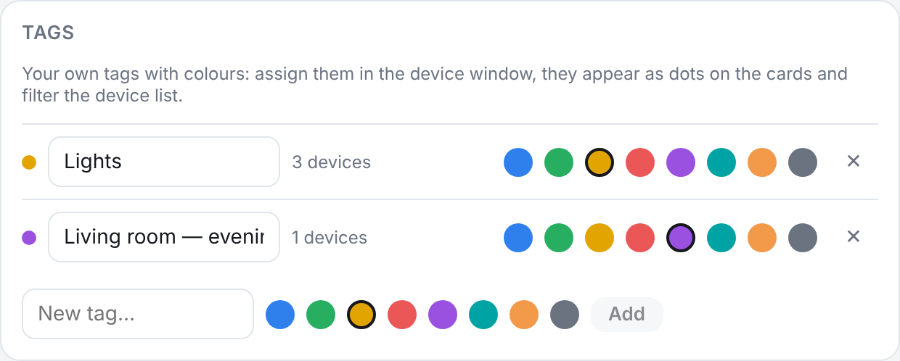 <em>Figure 40. The “Tags” block in Settings</em>

This block ([Figure 40](#fig-35-set-tags)) works like tag management ([section 10.4](#tag-edit) and [section 10.5](#tag-delete)): rename, recolor, delete with ✕ and confirmation, and create a new tag.

### 13.7 Backup

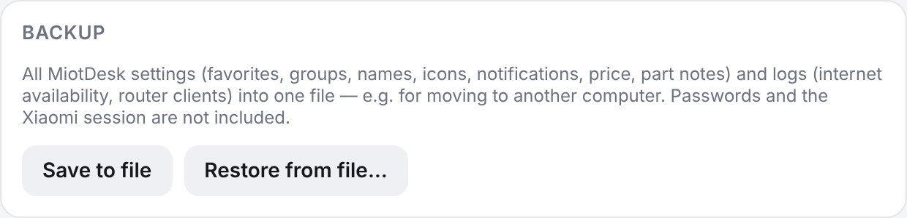 <em>Figure 41. The “Backup” block</em>

**Save to file** writes all MiotDesk settings (favorites, groups, tags, names, icons, notifications, price, schedules, power values, part records) and logs into one JSON file in the Downloads folder. The Xiaomi password and session are not included.

1. To restore, click **Restore from file…** and choose the file.
2. Check the number of entries and the date and click **Restore and restart**. *The current settings are replaced with the settings from the file.*

## 14. Several copies of MiotDesk

### 14.1 How synchronization works

If MiotDesk with the same account runs on several devices (computers, phone) in one local network, the copies find each other automatically. One of them becomes the **main copy** and talks to Xiaomi; the others get data through it over the local network, encrypted. The load on the Xiaomi account does not grow. No setup or pairing of copies is needed.

The Android copy becomes the main one if it is open on the screen or **Home server** mode is on; otherwise the copy started first. A secondary copy shows “Data comes through MiotDesk on “…” over the local network” and a **Take over** button that makes the current copy the main one.

### 14.2 Shared settings

Icons, tags, favorites, groups, order, hidden devices, schedules, timers, power values, limits and price are synchronized between copies. Language, layout, tile sizes, notifications and the refresh interval are separate for each copy.

> [!IMPORTANT]
> If the account has an Android copy, it is the main source of shared settings. A computer can change them only while connected to the Android copy; otherwise shared settings are read-only (“Shared settings are read-only”). To allow changes without the phone, click **Allow changes without Android** in the request statistics (Settings → Connection).

### 14.3 Home server on Android

The **Home server (run in background)** setting on the phone keeps the phone the main copy even with the screen off: computers on the same Wi-Fi get data through it. A permanent notification is shown and more battery is used.

### 14.4 Synchronization state

The **Sync between copies** line in the “Connection” block shows: “through “…” (encrypted, local network)”, “this copy serves N other(s)”, “no other copies on the network” or the reason there is no connection (see [section 16](#trouble)). Away from the home network, gateway sensors are refreshed every 5 minutes — this protects the gateway from hanging.

## 15. Data storage

| Data | Where it is stored |
|---|---|
| Xiaomi session tokens | Windows — Credential Manager; macOS — Keychain; Linux — Secret Service (keyutils); Android — the app's encrypted storage (key in Android Keystore) |
| Settings, tags, favorites, last state, energy cache | Local storage of the program's built-in browser on this device (Windows — in `%LOCALAPPDATA%\lt.igumenov.miotdesk`) |
| Error log | File `errlog.json` in the program data folder (Windows — `%APPDATA%\lt.igumenov.miotdesk`) |
| Device model descriptions (specifications) | Program cache folder |
| CSV files, backups and saved error logs | Downloads folder; existing files are not overwritten |

Complete removal of the program ([section 5.6](#uninstall)) deletes all of the above except the files in the Downloads folder.

## 16. Troubleshooting

| Symptom | Possible cause | What to do |
|---|---|---|
| All devices “offline”, devices that are on shown as off | No state received from the cloud (network failure, paused requests) | Wait for the next refresh or press ⟳. Check the toolbar timer: “⏸” means a pause requested by Xiaomi — wait until the time shown |
| Message about too frequent requests | Allowed request rate exceeded | Do nothing: requests resume automatically after at least 15 minutes. Increase the refresh interval |
| Statistics: “Region … unreachable” | The Xiaomi server of this region cannot be reached from your network (blocked by the provider or down) | Nothing to do: devices of this region show their last state, other regions refresh as usual, retry every 5 minutes. If the message stays for long, check these devices in Mi Home on the same connection |
| A device reacts slowly | Control through the cloud instead of the local network | Turn on **Prefer local network**; on macOS allow local network access; click **Scan local network** |
| No notifications | Notifications are off in the program or in the system | Turn on **System notifications** and click **Test notification**; check the OS notification settings |
| Sync: “main copy is an older version” / “different MiotDesk versions” | Copies of different versions | Update all copies to the same version |
| Sync: “cannot connect” | Firewall or Wi-Fi client isolation | Allow MiotDesk in the firewall (UDP 54329 and TCP 54330 in the local network) and turn off client isolation on the router |
| Sync: “too few common devices” | Copies signed in to different accounts | Sign in to all copies with the same account |
| Computer: “Shared settings are read-only” | The Android copy is not reachable | Open MiotDesk on the phone or click **Allow changes without Android** |
| Android: update does not install over the old version | The APK is not compatible with the installed version | Save a settings backup ([section 13.7](#set-backup)), uninstall the old version, install the new one and restore the settings |
| No energy statistics | Xiaomi provides no statistics for the period | Check the statistics in Mi Home; for devices without a meter enter the power ([section 11.3](#est)) |
| No tray icon (Linux) | The indicator library is not installed | Install the `libayatana-appindicator3-1` package |

Most of these problems are recorded in the error log ([section 13.5](#set-errlog)). When asking for help, click **Copy** or **Save to file** in the log and attach the text — it already contains the program version and the system, and secrets are removed.

## 17. Glossary

| Term | Definition |
|---|---|
| Mi Home | Xiaomi's official smart-home app |
| MIoT | Xiaomi's device description standard; MiotDesk builds the control window from it |
| Server region | The Xiaomi cloud server (Europe, China, USA, Russia, Singapore, India) where a device is registered |
| Local network (LAN) | The home network that the computer and the Wi-Fi devices are connected to |
| Gateway | A device that connects Zigbee and BLE sensors to the network (for example Mi Smart Home Hub) |
| Card (tile) | The rectangle of a device in the list |
| Tag | A user-defined colored label for grouping and filtering devices |
| Group | A set of devices switched on and off with one button |
| Scene | A set of Mi Home actions started manually |
| Automation | A Mi Home “if … then …” rule executed by the cloud or a gateway |
| Schedule | A MiotDesk action at a set time, executed by the program itself |
| Approximate consumption | Electricity use calculated from the entered power and operating time |
| Main copy | The MiotDesk copy that talks to Xiaomi on behalf of all copies in the network |
| Session token | An access key issued by Xiaomi after sign-in; replaces storing the password |
| Error log | The list of problems noticed by the program, grouped by type |
| CSV | A text table format that opens in Excel and other programs |

## Index

**A**  
[Account protection](#account-safety) · 2.2  
[Automations](#scenes) · 12.3  

**B**  
[Backup](#set-backup) · 13.7  

**C**  
[Card](#card) · 7.2  
[Card order](#order) · 9.3  
[Connectivity](#connectivity) · 12.5  
[Consumables](#consumables) · 12.2  
[Consumption, approximate](#est) · 11.3  
[Consumption, measured](#energy-plug) · 11.1  
[CSV](#dev-chart) · 8.5  

**D**  
[Data storage](#data) · 15  
[Device icon](#dev-head) · 8.1  

**E**  
[Electricity price](#energy-page) · 11.2  
[Energy section](#energy-page) · 11.2  
[Error groups](#set-errlog) · 13.5  
[Error log](#set-errlog) · 13.5  

**F**  
[Favorites](#fav-add) · 9.1  

**G**  
[Groups](#groups) · 9.2  

**H**  
[Hiding a device](#dev-head) · 8.1  
[Home overview](#overview) · 12.4  
[Home server](#sync-android) · 14.3  

**I**  
[Installation](#install) · 5  

**M**  
[Main copy](#sync-how) · 14.1  

**N**  
[Notification limits](#dev-sensor) · 8.4  
[Notifications](#set-notify) · 13.3  

**P**  
[Power, entering](#est) · 11.3  
[Privacy](#privacy) · 2.3  

**R**  
[Refresh interval](#set-conn) · 13.4  
[Removal](#uninstall) · 5.6  
[Robot vacuum](#dev-vacuum) · 8.6  

**S**  
[Scenes](#scenes) · 12.3  
[Schedules](#schedules) · 12.1  
[Server region](#login-proc) · 6.1  
[Sign-in](#login-proc) · 6.1  
[Sign-out](#logout) · 6.4  
[Synchronization of copies](#sync) · 14  

**T**  
[Tags — assigning](#tag-assign) · 10.2  
[Tags — creating](#tag-create) · 10.1  
[Tags — deleting](#tag-delete) · 10.5  
[Tags — filter](#tag-filter) · 10.3  
[Tags — renaming](#tag-edit) · 10.4  
[Timer](#dev-timer) · 8.3  
[Tray](#tray) · 7.4  
[Troubleshooting](#trouble) · 16  
[Two-step verification](#login-2fa) · 6.2  

**U**  
[Update](#update) · 5.5  

**V**  
[Verification code](#login-2fa) · 6.2  

---

MiotDesk 0.12.0 · User Manual, edition 1.2 · © 2026 Aleksandr Igumenov · MIT License.
“Xiaomi”, “Mi Home” and “Xiaomi Home” are trademarks of Xiaomi Inc. Screenshots were taken in the program's demo mode; device names and readings are fictitious.
